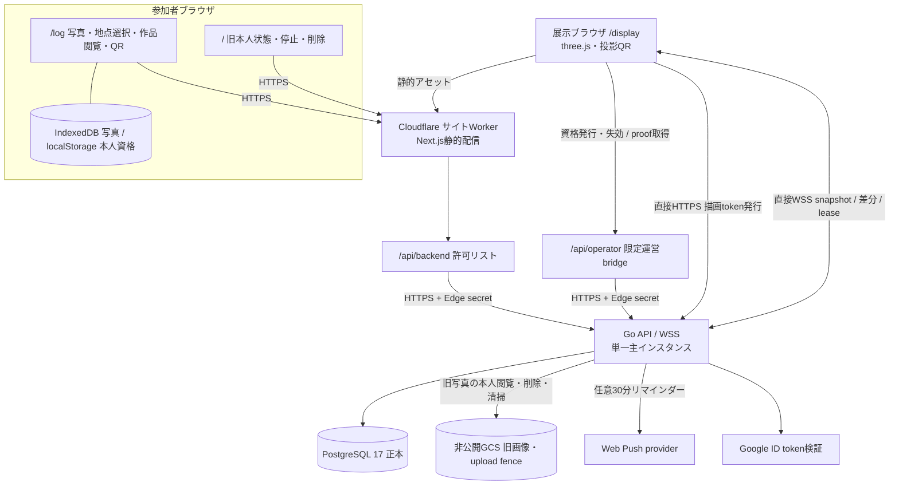

# システム構成（完成版）

更新日: 2026-11-06

会期（2026-10-31〜11-01）終了後の実装仕様を記録する。基準はFrontend `be94bd2`、Backend `6b87961`、DB migration `001`〜`020`。コードの存在・会期中の配備記録と、現在の稼働、削除完了、費用停止、正式承認、実機試験の完了は別である。文書改訂で機能flagやクラウドを変更しない。

## 全体構成

図はソフトウェアの境界を表し、現在の配備・ネットワーク疎通を保証しない。会期中構成はCloudflareサイトWorker＋Google Cloud Run／Cloud SQL PostgreSQL 17／旧非公開GCS。Google Cloud東京の構成方針とCloudflare側の処理地域を混同しない。[インフラ・データベース方針](infrastructure-database-decision.md)も参照する。

## Web App

- `/log`は公開設定の同意文・版・言語を表示し、明示同意とMemory作成成功後に参加する。API失敗を端末だけの参加成功に置き換えない。
- 新しいGPS取得・送信は行わない。写真ごとに参加者が固定Graphの地点を選ぶ。
- EXIFを引き継がず縮小・再エンコードしたJPEGはIndexedDBにのみ保存する。サーバーへの新規送信は`clientPhotoId`、`checkpointId`、`capturedAt`だけである。端末写真は最大12枚・合計30MiBを境界とする。
- 到着後も参加期限内なら端末撮影を続けられるが、到着後に撮った写真はGoへmetadataを追加送信しない。Go API自体の写真追加可否とFrontendの送信方針を分ける。
- 「作品を見る」は到着前から本人端末の写真・3D経路・作品画像保存へ進む。カメラ起動、到着登録、再予約、参加状態変更、通知停止を伴わない。ローカル作品のShibaLabへの経路はGoの到着登録と独立して構成する。
- QR読取だけが展示への初回到着／完了後の新規再視聴を申し込む。proofは同一originの`/log` URLのfragmentに載せ、本人BearerをQRやURLに載せない。参加前に読んだproofは参加後へ持ち越さない。
- `/`は既存Memory／旧Liveの本人状態・停止・削除を維持する。端末内の旧精度記録は閲覧・削除用に残り、新しい測位や再送には用いない。

## Go Backend

| 責務 | 完成仕様 |
|---|---|
| 参加 | `/v1/experiences`でMemoryとExperienceを作成。Live新規発行なし。Memoryに同意版、Graph版、保存方式、到着後通知方針を固定 |
| 写真 | 新規deviceは`/v2`metadataのみ。旧legacyは`/v1`本人閲覧・削除とGCS清掃を維持。新規uploadは現行構成で無効 |
| 経路 | 撮影順の自己申告checkpoint間を固定Graphで接続し、到着時は最後の写真から到着地点を追加。実測歩行履歴ではない |
| 到着 | 25秒の署名proof検証、Memoryごとのproof fingerprint消費、初回到着と再視聴receipt分離 |
| 展示 | PostgreSQL永続FIFO、最大50待機・全体1再生、単一主lease、snapshotと連番差分 |
| 本人権利 | 停止と削除の分離、`expiresAt`と`deleteAfter`の分離、旧Live自身のBearerによる照会・停止・削除 |
| 通知 | 別途の任意同意とブラウザ許可に基づくGo Web Push、30分のみ。既存Memoryの到着後通知方針は変更しない |
| 運営 | Google本人確認から発行する個人別operator credential、監査、受付／全通知停止、skip／障害retry、fallback |
| 清掃 | 期限処理、旧画像消去失敗時のdeleting再試行、署名PUTのfence/outbox清掃 |

## データ配置

| データ | 保存先 | 境界 |
|---|---|---|
| 新規写真本体・ローカル作品 | 参加端末のIndexedDB等 | Go／GCS／描画WSSへ送らない。サーバー清掃だけでは消えない |
| Memory、自己申告地点・撮影時刻、経路、到着、同意・期限 | PostgreSQL | セッション／写真／経路の物理テーブルをdeviceとlegacyで分離 |
| 本人資格 | 端末localStorage、DBはhash | Memoryと旧Liveを別Bearerで扱う。本人削除と端末消去を連携 |
| 旧クラウド写真 | 非公開GCS | 期限内の本人用短命URL、消去確認、fence清掃に必要な権限を残す |
| 旧Live最新位置キャッシュ | 単一Goプロセスメモリ | TTLまでの互換清掃対象。新規書込みも公開描画への投影もない |
| Push endpoint・鍵 | PostgreSQLの暗号化列 | 任意同意、期限／解除／停止で消去。画像や位置を通知payloadへ入れない |
| 描画cursor／差分／lease／receipt | PostgreSQL | 参加者資格・画像・生GPSなし。公開再生世代IDで照合 |
| 運営資格・監査 | PostgreSQL | 資格hash、Google subject由来actor hash、メール照合hash。生Google tokenや生メールを保存しない |

`experiences`、`experience_links`、物理schemaの詳細は[データモデル](data-model.md)を正とする。D1/KVを使う旧`trace-push`調査系と、独立本番のGo通知・PostgreSQLを混同しない。

## 描画

採用済み描画はFrontendの`/display`（three.js）。固定Graphのnode ID列を同梱3Dモデルの座標へ変換し、経路と撮影地点・時刻を抽象表現として再生する。写真画像・画像URL、Memory ID、Live位置を表示イベントへ含めない。

Googleログインを共有しても、描画用`displayToken`とQR発行等の個人`operatorToken`は独立取得・独立認可する。描画token発行とWSSはGoへの直接接続で、Edge secretを要求しない専用Origin境界。WSSの最初のtext frameで認証してからsnapshotを配信する。主leaseを持つ1接続だけがFIFO先頭の再生開始・完了・失敗を確定でき、待機接続は受信だけを行う。[API・WebSocket仕様](api.md)を参照。

fallbackはDBに`normal`／`pending`／`fallback`を永続化する。進行中の1件を待つ`pending`は最大30秒で切り替え、新規開始を拒否する。待機列・到着受付は維持し、復帰は明示DELETEだけ。映像出力機材・音響の現在稼働は本書から断定しない。

## セキュリティ境界

1. 参加者は同一originの`/api/backend/*`だけを使い、Workerがサーバー側Edge secretを付ける。ブラウザからの転送IPを信用せず、Cloudflare由来IPだけを取り扱う。
2. 本番`/api/operator`は資格発行・現在／本人全資格の失効・到着proof取得の4経路のみ。status、受付停止、全通知停止、fallback、skip／retryは中継しない。これらには別途認可済みの運営経路が必要。
3. 会期前リハーサルのloopback brokerは別環境。現在の本番bridgeの必須構成として記さない。
4. Origin許可、Edge secret、Google本人確認、個人運営資格、描画資格、Memory資格、旧Live資格は相互の代用品にならない。Cloud Run IAMも別境界であり、Edge secretでIAM非公開サービスへ到達できるわけではない。
5. 本人閲覧・削除と期限清掃が残る間は、それを壊す一括停止を行わない。受付停止、全通知停止、参加停止、削除、クラウド停止は別操作。

## 拡張境界

最大1 APIインスタンスを前提とする。DB上のlease／FIFOがあっても、レート制限、接続数、旧位置メモリはプロセス単位である。複数revision・複数APIへ無条件に拡張しない。migrationは明示適用し、API／dispatcher／cleanupをschema 20対応版へ揃える。実適用状況は未確認。

## 変更履歴上の整理

| 旧案 | 完成仕様 |
|---|---|
| 通常GPS・撮影時GPSの新規送信 | 廃止。固定Graphの自己申告地点 |
| 新規GCS写真upload | 端末保存とv2 metadataへ切替。旧画像の権利・清掃だけ継続 |
| 写真pin・hotspot／Unity・TouchDesigner | 現行構成では使用しない。three.jsと経路・撮影地点metadata |
| 運営による毎回の手動play | 主描画機がFIFO先頭を自動要求 |
| 15分または30分通知／到着時停止 | 30分のみ。従来の停止方針を保ち、継続は新同意版で作成した新Memoryに固定 |

## 実装参照

- [Frontend README（画面・本番境界・会期中記録）](https://github.com/Mino829/TRACE_F/blob/be94bd2/README.md)
- [サイトWorker（参加者／限定運営bridge）](https://github.com/Mino829/TRACE_F/blob/be94bd2/push-worker/src/site.ts)
- [Go API登録・公開設定・作成](https://github.com/Mino829/TRACE_B/blob/6b87961/internal/api/server.go)
- [metadata・経路](https://github.com/Mino829/TRACE_B/blob/6b87961/internal/store/photo_moments.go)、[描画状態・lease](https://github.com/Mino829/TRACE_B/blob/6b87961/internal/store/display.go)
- [schema 001〜020](https://github.com/Mino829/TRACE_B/tree/6b87961/internal/store/migrations)、[Backend README（通知・清掃・運営）](https://github.com/Mino829/TRACE_B/blob/6b87961/README.md)
