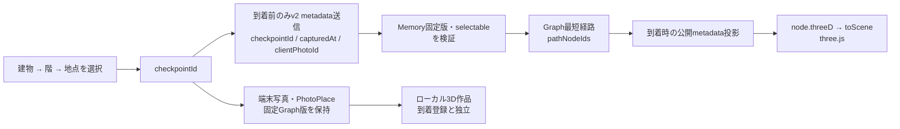

# 位置座標・3D座標変換（完成版）

更新日: 2026-11-06

基準: Frontend `be94bd2`／Backend `6b87961`。完成版の入力は新規GPSではなく、参加者が写真ごとに選んだ固定Graphのcheckpointである。新規位置取得→geofence→平滑化→公開位置表示という旧パイプラインは使わない。Graph内の地理座標や旧写真用処理が存在することを新規測位の仕様に読み替えない。

## 目的

撮影地点を自己申告の記憶アンカーとして、固定キャンパスGraph上の経路と3D Mapを一貫させる。再構成経路は参加者の実歩行履歴・測量結果・精密な現在位置ではない。本人端末の作品と展示の到着再生は別の導線を持ち、ローカル作品を開くために到着QRを必須にしない。

## 処理順序



画像、座標、Graph版、role、selectableを写真POSTへ追加しない。Goは作成済みMemoryの版と自分の固定Graphを使用する。Frontendは到着後も端末撮影できるが、その追加写真metadataはGoへ送らない。

## 基準点と座標系

一つの座標をすべての用途へ転用せず、次を区別する。

| 座標 | 役割 |
|---|---|
| Graph `lat`／`lon` | 固定キャンパスのWGS84参照値。参加端末から新しく得た位置ではない |
| Graph `local.east`／`local.north` | アプリのローカルENU平面メートル。Goの経路pathのx／zはeast／north |
| Graph `threeD.x/y/z` | Blenderキャンパス座標、1単位=1m、Z上。階・階段・エスカレーター等の描画位置 |
| three.js scene | GLBに合わせたY上座標。node IDを介してGraph threeDから変換 |
| placesの地点選択図 | `places.json`のoriginを引いた小さい座標。選択結果はcheckpoint IDで保存 |

Graphの最初のnodeは`classroom-entrance`、教室棟1F南面自動ドアに対応するアプリ原点。現在の固定値はlat 35.6607341、lon 139.7945577、local east 0.01／north 0.0。Backendは最初のnodeの地理／local値から参照変換を構成する。原点を会場到着地点ShibaLabと同一視しない。

旧地理アンカーとGraph整合検査に使う近似式（角度差はラジアン）:

```text
east  = originEast  + 6378137 * cos(originLat) * (lon - originLon)
north = originNorth + 6378137 * (lat - originLat)
```

Backend Parseは各nodeのlocalとWGS84変換結果の差が0.3m以内かを検査する。これは固定データの内部整合検査であり、実地GPS精度の合格値ではない。

## 3Dへの変換

Frontend `src/lib/display/campus-graph.ts`の`toScene`はBlender XYの原点とZ上をGLBのY上へ変換する。

```text
origin = { x: -160.48048400878906, y: -14.865501403808594 }
sceneX = threeD.x - origin.x
sceneY = threeD.z
sceneZ = -(threeD.y - origin.y)
```

このoriginはGLBの書出し基準であり、上のENU原点とは別物。Goのpath.x／zをこのBlender座標式へ直接代入しない。展示は`pathNodeIds`から同梱Graphのnode.threeDを引いて、`buildRoutePath`で経路を組み立てる。`/display/campus.glb`を読み、階・上下移動を含む3D上の経路として描く。新仕様を「全高さ固定」と説明しない（Goの平面pathと3D描画は別）。

カメラ移動・エスカレーター／エレベーター演出・見やすさの平滑化は描画側の表現。新しいGPS平滑化や実移動速度の計測ではない。

## 写真地点と経路グラフ

- 新規写真はGraphに存在し、`selectable:true`が明示されたnodeだけ。roleがcheckpointかroomかwaypointかでは可否を決めない。unknown／false／null／属性欠落は400 `INVALID_CHECKPOINT`。
- 内部経路nodeと到着証明の地点解決は`NodeIndex`を用い、写真の選択可能性とは分ける。到着地点や中継waypointすべてを新規写真選択肢にするわけではない。
- `photo_moments`をcaptured_at、sequence_noで並べ、隣接写真間を`Graph.Connect`のDijkstraで接続する。algorithmは`checkpoint-dijkstra-1`。同一地点も正当な区間として扱う。
- 辺のlengthMetresを重みにし、passable=false、restricted、closedを除外する。openingHours（JST曜日／時刻）とclosuresを含む場合、撮影区間全体で利用可能な辺だけにする。
- checkpoint経路はGPS精度円・速度推定・候補snap競合を使わない。有効な最短経路は内部confidence high、逆時刻・不明node・接続不能はlow／空経路。highは自己申告地点間のGraph接続の評価で、実歩行の証明ではない。
- 初回到着時、最後の写真が初回arrived_at以前なら、その写真→到着checkpointの区間を追加する。0枚は区間なし、1枚でも到着区間を作れる。再視聴時刻で経路を延ばさない。
- 写真個別削除・追加で全隣接を同transactionで再構成する。版不一致の旧checkpointを現行位置へ読み替えない。

公開描画の投影は、写真・区間の版、開始／終端写真、区間数と連続性を照合する。不足区間や連続しないpathを部分的な実軌跡としてつなぎ直さず、空経路にする。描画へ送る撮影情報はcheckpointId／capturedAtのみで、画像やMemory IDを含めない。

## 座標・グラフ・3D Mapの版同期

| 項目 | 同梱版 |
|---|---|
| coordinateVersion | `toyosu-2026-08-28.1` |
| campusGraphVersion | `toyosu-graph-2026-10-29.1.draft` |
| threeDMapVersion | `toyosu-3dmap-2026-10-30` |

Graph名の`.draft`は実際の版文字列として維持し、「完成版」文書にするために勝手に変更しない。版名は大学／責任者の公開承認を表さない。

Backendの固定JSONは`internal/route/campus_graph.json`、Frontendは`models/trace/campus_graph.json`。3種の版が設定と一致しなければBackendのGraph互換検査が拒否する。Memoryには受付時のGraph版を固定し、写真と区間にも版を保存する。本人v2 memoryはgraphVersionとpathNodeIdsを返す。新しいGraph配備で旧Session／写真の版を上書きしない。

描画認証frame・送受信メッセージは3種の版を持つ。不一致は描画せず認証close／version rejectionとする。snapshotは参加者位置一覧でなく、現在の到着再生metadataとfallback。公開設定の版、Frontend同梱Graph、GoのJSON、GLBと生成placesを同じ互換組に揃える。旧bundleのnode IDが同名でも新座標へ解釈し直さない。

## 制作物と責任分界

| 制作物 | 現行用途 |
|---|---|
| `models/trace/campus_graph.json` | 選択地点・内部node・辺・版・Blender座標の固定データ |
| Backend埋込Graph | 入力selectable検証、版固定、経路再構成、旧地理アンカー互換 |
| `places.json` | 建物・階・地点選択用の生成済みデータ、PhotoPlaceの版照合 |
| `/display/campus.glb` | three.jsの固定3Dキャンパス |
| `campus-graph.ts`／`route-path.ts` | node ID→scene変換・3D経路、合成展示の経路補助 |

地図・Graph・モデルのコードは存在するが、実地の通行可能性、誤差、端末／投影機材の試験合格を本書は報告しない。再展示時の現地変更・互換版切替・公開承認は別の確認事項である。

## 旧GPS互換と表示上のプライバシー

旧`photos`に保存されたGPS由来区間は本人閲覧・削除のために保持し、`photo-edges-dijkstra-1`による旧辺投影・推定処理を残す。新規device metadataにGPS列や新規位置を追加しない。端末の旧精度記録も再送しない。

旧Liveの最新位置キャッシュはTTL清掃対象のみ。新規位置書込も描画へのposition投影もない。写真pin／hotspotの量子化・集計は現行機能ではない。公開画面が示すのは自己申告地点間の再構成で、写真画像・URL・生GPS・本人資格を送らない。ただし撮影地点と時刻自体は公開metadataになるため「画像を送らない＝行動情報が一切ない」と説明しない。

## 実装参照

- [Backend固定Graph](https://github.com/Mino829/TRACE_B/blob/6b87961/internal/route/campus_graph.json)、[Parse／Compatible／PhotoCheckpointNode／Connect](https://github.com/Mino829/TRACE_B/blob/6b87961/internal/route/route.go)
- [撮影順・到着終端・版不一致](https://github.com/Mino829/TRACE_B/blob/6b87961/internal/store/photo_moments.go)、[公開経路の完全性検査](https://github.com/Mino829/TRACE_B/blob/6b87961/internal/store/display.go)
- [Frontend Graph・toScene](https://github.com/Mino829/TRACE_F/blob/be94bd2/src/lib/display/campus-graph.ts)、[3D経路](https://github.com/Mino829/TRACE_F/blob/be94bd2/src/lib/display/route-path.ts)、[GLB描画](https://github.com/Mino829/TRACE_F/blob/be94bd2/src/lib/display/player.ts)
- [地点選択・PhotoPlace型](https://github.com/Mino829/TRACE_F/blob/be94bd2/src/lib/places/types.ts)、[同梱版と会期中記録](https://github.com/Mino829/TRACE_F/blob/be94bd2/README.md)
