# データモデル

## 方針

- 本番の正本DBはMVPからマネージドPostgreSQLとする。Google CloudではCloud SQL、AWSではRDSを使用し、標準PostgreSQLの範囲を基本として移植性を保つ
- 新規の写真バイト列はWeb Appの参加端末内だけに保存する。PostgreSQLへは`client_photo_id`・`checkpoint_id`・`captured_at`など経路用の最小メタデータだけを保存し、Cloud Storageや描画機へ新規画像を送らない。旧Cloud Storage写真は既存セッションの`delete_after`まで本人照会・削除・期限清掃を維持する
- GPS（Geolocation API、撮影時位置取得）は使用しない。緯度経度・位置履歴のテーブルや列を新設しない。写真地点は参加者が3Dマップで選んだ`checkpointId`のみを保存し、座標・対応ノードIDの解決はBackendがCampusGraphから行う（2026-10-26決定、#23）
- セッションは`MemorySession`単独とする。`LivePresenceSession`は新規発行しない。旧Sessionは各`deleteAfter`まで照会・停止・削除可能な実データとして残し、前倒し削除しない（2026-10-26決定、#23、採用5）
- `ExperienceLink`、`display_alias`、`on_site_consent_version`は廃止した（2026-10-26決定、#23）
- サーバーの写真メタデータ・チェックポイント地点・経路・削除冪等性記録は同一期間で一緒に消す。端末内画像は別領域で、Web Appが削除・期限を検知したときに消す。端末を開かない間の即時消去や明示的に写真アプリへ保存した複製の消去は保証しない
- 個人名、学籍番号、メールアドレス、端末固有IDを保存しない
- 各セッションの`expires_at`（新規操作の期限）と`delete_after`（保存データの削除期限）を分離し、失効後も本人の読み取り・自己削除を`delete_after`まで許可する。開発側既定は`expires_at`=作成から6時間、`delete_after`=失効後24時間（2026-10-26決定、#23）。APIセキュリティログ30日・DBバックアップ最大7日は提案値であり、大学承認待ちである

## ER図

図中の`string id`は論理識別子の表記である。セッション、写真、経路等の識別子と参照先は既存の推測困難なプレフィックス付き不透明IDを維持し、PostgreSQLでは`text`型で揃える。UUIDv7や`uuid`型への変更は行わない。

```mermaid
erDiagram
    MEMORY_SESSION ||--o| ARRIVAL_EVENT : reaches
    MEMORY_SESSION ||--o{ PHOTO_MOMENT : captures
    MEMORY_SESSION ||--o{ PHOTO_MOMENT_FENCE : prevents_replay
    MEMORY_SESSION ||--o{ ROUTE_SEGMENT : reconstructs
    MEMORY_SESSION ||--o| PUSH_SUBSCRIPTION : enables
    CAMPUS_CHECKPOINT ||--o{ PHOTO_MOMENT : anchors
    CAMPUS_NODE ||--o{ CAMPUS_EDGE : connects

    MEMORY_SESSION {
        string id PK
        string status
        string consent_version
        string consent_language
        string token_hash
        string campus_graph_version
        datetime consented_at
        datetime started_at
        datetime expires_at
        datetime delete_after
        datetime created_at
    }

    CAMPUS_CHECKPOINT {
        string id PK
        string graph_version
        string node_id FK
        boolean enabled
    }

    PUSH_SUBSCRIPTION {
        string memory_session_id PK
        string endpoint_encrypted
        string keys_encrypted
        integer interval_minutes
        string status
        datetime next_send_at
        datetime expires_at
    }

    ARRIVAL_EVENT {
        string id PK
        string memory_session_id FK
        string source
        string checkpoint_id
        string replay_status
        string skip_reason
        datetime arrived_at
        datetime replay_started_at
        datetime replay_finished_at
    }

    PHOTO_MOMENT {
        string id PK
        string memory_session_id FK
        string client_photo_id
        string checkpoint_id FK
        integer sequence_no
        datetime captured_at
        datetime delete_after
        datetime created_at
    }

    PHOTO_MOMENT_FENCE {
        string memory_session_id FK
        string client_photo_id PK
        datetime delete_after
    }

    ROUTE_SEGMENT {
        string id PK
        string memory_session_id FK
        string from_photo_id FK
        string to_anchor_type
        string to_anchor_id
        string graph_version
        string path_node_ids
        float length_m
        datetime started_at
        datetime ended_at
    }

    CAMPUS_NODE {
        string id PK
        string graph_version
        string node_type
        float local_x
        float local_z
    }

    CAMPUS_EDGE {
        string id PK
        string graph_version
        string from_node_id FK
        string to_node_id FK
        string path_points
        float length_m
        string attributes
        boolean enabled
    }

    DISPLAY_CLIENT {
        string id PK
        string name
        string renderer_type
        string status
        string role
        datetime lease_expires_at
        datetime last_seen_at
    }

    IDEMPOTENCY_RECORD {
        string scope PK
        string key_hash PK
        string request_hash
        integer response_status
        string deletion_result
        datetime expires_at
    }

    OPERATOR_AUDIT_LOG {
        integer id PK
        string operator_id
        string action
        string target_type
        string target_id_short
        string result
        datetime created_at
    }
```

`DISPLAY_CLIENT`は参加者データと関連付けない。描画機の接続監視だけに使用する。

`IDEMPOTENCY_RECORD`は到着、削除の重複適用を防ぐ。キーそのものではなくハッシュ、操作スコープ、リクエスト内容のハッシュ、返却結果、有効期限を最大24時間保存する。同じキーで異なる内容が来た場合は競合として拒否する。削除冪等性記録は写真・チェックポイント地点・経路と同一期間で一緒に消す。削除記録はID、資格情報、写真やセッション内容を含めず、削除状態を安全に再現できる短期receiptとする。

`OPERATOR_AUDIT_LOG`は受付停止、再生、skip、fallbackなどの運営操作を記録する。位置情報、参加トークンを含めず、対象IDも運営上必要な短縮表現にする。

### 廃止エンティティ

`LivePresenceSession`、`LivePosition`、`ExperienceLink`、`display_alias`、`on_site_consent_version`、`PhotoHotspotBucket`、写真の緯度経度列・`location_source`・`snapped_edge_id`・信頼度列は廃止した（2026-10-26決定、#23）。既存環境に残る旧テーブル・旧列は新規書き込みを行わず、旧Sessionの照会・停止・削除と各`deleteAfter`までの期限清掃のみに使う実データ契約とする（#23採用5）。旧GPSデータは`deleteAfter`まで保持し、前倒し削除しない。

## PostgreSQL実装規約

- セッション、写真、経路等のdomain entityの主キー・参照列は既存のプレフィックス付き不透明な`text` IDを保持する。UUIDv7への一括変更はせず、同じIDを使う外部キーの型も`text`で合わせる
- 外部へ公開しない追加の連番が必要な監査・集計テーブルだけ、`bigint generated always as identity`を使用できる
- すべての時刻列は`timestamp with time zone`としてUTCで保存する
- 状態値は`text`と`check`制約を基本とし、アプリだけでなくDBでも未知の状態を拒否する
- 外部キー列には参照・削除で使用するインデックスを作る。PostgreSQLは外部キー列のインデックスを自動作成しないため、migration reviewで漏れを検査する
- Goは上限付き接続プールを共有し、リクエストごとにDB接続を作らない
- migrationはGitで連番管理し、後方互換のあるexpand-contract方式で適用する。production起動時に破壊的migrationを自動実行しない
- 旧写真の期限清掃を複数workerで行う場合は短いトランザクションと`FOR UPDATE SKIP LOCKED`を原則とし、外部I/O中のDB lock保持を避ける。ただし既存Backend #6のadvisory lock例外は旧オブジェクトの消去が終わるまで維持する。新しいメタデータ登録にはこの例外を適用しない
- 日付partition、read replica、provider固有extensionはMVPで先行導入せず、実測した件数、query、VACUUM、復旧要件に基づいて判断する

### 新規の写真メタデータと旧写真実装

新方式では`PhotoMoment`をセッションにつき最大12件保存し、`client_photo_id`をセッション内で一意にする。`checkpoint_id`・`captured_at`・受付順と`memory_session_id`を持ち、画像Blob・画像のハッシュ/寸法/URL・オブジェクトキー・`PhotoAsset`は新規作成しない。`client_photo_id`は同じブラウザのIndexedDB上の画像と照合するための不透明IDであり、Backendから画像の存在を検証できない。Backendへのメタデータ受理と端末の画像保存・削除は別の結果として扱う。新規契約は[API仕様](api.md)の`/v2`を参照する。

旧Backend #6の物理`photos`行、`photo_upload_fences`と非公開Cloud Storageは移行前の写真に限り維持する。旧Sessionの本人閲覧・写真単位/全体削除・`delete_after`期限清掃では、旧objectを消去した後で参照レコードを消す。既発行PUT URLが残る写真のゼロバイト占有と期限後のoutbox清掃は、旧画像を失踪・再出現させないため残す。旧方式で承認されたadvisory lockと外部I/Oの直列化（API/清掃10秒、起動30秒のdeadline）は旧データの消去だけの契約であり、新規メタデータ作成へ適用しない。旧写真を無断で前倒し削除しない。migrationは旧読取/削除経路を維持したまま新規画像受付を止めるexpand-contract方式とし、旧データの期限清掃を実測・確認してから旧列/ストレージを廃止する。

## MemorySession

写真のメタデータ、チェックポイント地点、経路、到着演出を管理する単一セッションである（#23）。写真Blobと本人画面の画像表示は端末内に限る。セッション作成時の`campus_graph_version`を記録し、写真地点`checkpointId`の検証と経路再構成に使う。現行Backendの写真オブジェクト保存とは異なる未実装契約であり、旧Sessionの画像消去責任は残る。

- `status`: `main`（体験中）、`arrived`（到着済み）、`ended`（終了）。`on_site`概念は廃止
- `consent_version`: 旧草案`2026-memory-photo-no-gps-draft-1`はサーバー写真保存を前提とし、新方式に再利用しない。新しい版・本文と正本の所在は#9で関係者と相談・大学審査後に決定する。承認前は新方式のセッションを発行しない
- `expires_at`後は写真登録などの新規操作を受け付けず、本人の状態・写真の閲覧と自己削除は`delete_after`まで許可する。開発側既定はTTL 6時間・`delete_after`失効後24時間

## 廃止エンティティ（旧Session読み取り契約）

旧`LivePresenceSession`は新規発行しない（2026-10-26決定、#23）。既存の旧Sessionは本人資格での状態照会・停止・削除と各`deleteAfter`までの期限清掃のみが有効である。`tracking_status`は`tracking`、`stopped`、`expired`のまま。旧GPSデータ（旧描画位置イベント・写真の緯度経度列を含む）は読み取り契約のみ（TRACE_B#30）で、前倒し削除せず`deleteAfter`まで保持する。`ExperienceLink`・`display_alias`・`on_site_consent_version`は廃止し、新規の関連付け・照合表示は行わない。セッションはMemorySession単独である。

## ArrivalEvent

到着はセッションにつき最大1件とする。同じMemorySessionからの本人認証済み再送はQRの期限後も同じArrivalEventと現在の再生状態を返す。

- `source`: `qr`。到着は有効な展示ブースQRでのみ成立する
- `replay_status`: `queued`、`playing`、`completed`、`skipped`
- `checkpoint_id`: 到着場所（ShibaLab）の識別子。署名付き証明そのものは保存しない
- `skip_reason`: 参加者選択・描画機障害・運営操作など。現Backend Draft PR #34は`queue_full`・`timeout`も持つが、通常待機を30秒でskipしない方針と不一致。待機上限・満杯・障害時の扱いと移行は未決

到着は展示ブースで投影・定期更新する署名・期限付きQRのBackend検証でのみ成立する（2026-10-26決定、#11）。受付ではMemorySessionへArrivalEventを作成し、`status`を`arrived`へ変更して撮影通知を停止する。写真0枚・1枚でも到着は成立する（2026-10-26決定、#23）。再生状態はArrivalEventだけを正とし、MemorySessionへ`replaying`を重複保存しない。

## PhotoMoment（新規メタデータ）

`PhotoMoment`は参加者の撮影した写真のID・地点・時刻をBackendへ伝える記録であり、画像データ自体は端末のIndexedDBだけに置く。新規`PhotoAsset`は作らない。GPSやEXIF、画像特徴はBackendへ送らない。

| 項目 | 内容 |
|---|---|
| `client_photo_id` | 端末が生成した不透明ID。MemorySession内でunique。端末の画像との照合用 |
| `sequence_no` | セッション内の受付順。unique。本人画面は撮影時刻順に表示 |
| `checkpoint_id` | 参加者が選んだ写真地点。`CAMPUS_CHECKPOINT`参照。必須。座標・ノードIDはBackendがCampusGraphから解決 |
| `captured_at` | 端末申告の撮影時刻。公開表示の正確な時刻には使わない |
| `delete_after` | セッション削除期限以下。サーバーメタデータだけに適用 |

1セッション12件を暫定上限とする。端末はEXIF除去・再エンコードして最大30MB/12枚を上限として保持する。写真単位削除はサーバーメタデータ・地点・経路を更新し、Web Appが当該端末内画像を別に削除する。Web Appが開かれていなければ`delete_after`時刻ちょうどのローカル消去は保証できない。旧サーバー写真の`PhotoAsset`と削除は上の旧実装契約を参照する。

削除済み`client_photo_id`の遅延したオフライン再送で写真が復活しないよう、`photo_moment_fences`にセッションID・client IDを保存する。写真単位削除とfence作成、経路の再計算を同一DBトランザクションで行う。同じIDの後続POSTは404とし、セッション削除・`delete_after`期限清掃でfenceも消す。通常の24時間以内の冪等性記録だけではセッションの`delete_after`まで復活を防げないため、このfenceは画像や地点・時刻を持たずセッションの期限まで残す。旧`photo_upload_fences`とは別のメタデータ用契約である。

## RouteSegment

前の写真から次の写真、または最後の写真からShibaLab（到着）までの再構成経路。写真を撮った順に各写真の地点（チェックポイント）をCampusGraph最短経路でつなぐ。

- `from_photo_id`: 区間開始のPhotoMoment
- `to_anchor_type`: `photo`または`arrival`
- `to_anchor_id`: 次のPhotoMomentまたはArrivalEvent
- `graph_version`: 使用したCampusGraphの版
- `path_node_ids`: グラフの点IDの並び。生緯度経路を含めない
- `length_m`: 区間長。再生時間の比例配分に使う

生成時の入力は区間両端の写真地点（`checkpoint_id`）だけである。同じ入力と`graph_version`から再生成できるよう、経路生成アルゴリズムの版も設定またはメタデータへ記録する。再生は全体10〜20秒で区間の長さに比例配分し、写真地点で少し停止する。撮影時刻間隔の比例配分は使わない。信頼度・確からしさ表現は廃止した（2026-10-26決定、#23）。

## PushSubscription

MemorySessionに紐づく任意参加の撮影リマインダー。30分ごとのリマインダーのみを継続し、精度テスト用10分通知は廃止した（2026-10-26決定、#23）。ブラウザの購読エンドポイントと鍵は暗号化し、通知本文に写真、参加記号、経路を含めない。到着、停止、購読解除、期限切れの最も早い時点で無効化・削除する。通知時刻は厳密な保証をせず、端末内タイマーを補助表示として使える。購読情報の配置（D1維持 vs Go移管）はTRACE_B#12で未決であり、決定として扱わない。

## CampusNode・CampusEdge・CampusCheckpoint

キャンパス内の歩行可能経路を表すバージョン付きグラフ。CampusEdgeは距離、屋内外、階段、スロープ、エレベーター、利用時間、通行止め、バリアフリー可否を属性として持つ。公開中のグラフを直接上書きせず、新しい版を検証してから切り替える。`CAMPUS_CHECKPOINT`は写真地点・到着QRの候補地点であり、`node_id`でグラフ上の点を指す。チェックポイント一覧の粒度は未決である（実装PRは82点、ポケモンGO風8か所スポット案の採否含む。Mino829/TRACE_F#38）。決定として扱わない。

## インデックス

- `memory_sessions(delete_after)`
- `memory_sessions(status, expires_at)`
- `arrival_events(replay_status, arrived_at)`
- `photo_moments(memory_session_id, sequence_no)` unique（新規メタデータ）
- `photo_moments(memory_session_id, client_photo_id)` unique（同一写真の冪等登録）
- `photo_moment_fences(memory_session_id, client_photo_id)` unique（削除後の再送・復活防止）
- `route_segments(memory_session_id, started_at)`
- `push_subscriptions(status, next_send_at)`
- `campus_nodes(graph_version)`
- `campus_edges(graph_version, enabled)`
- `campus_checkpoints(graph_version, enabled)`
- `display_clients(last_seen_at)`
- `idempotency_records(scope, key_hash)` unique
- `idempotency_records(expires_at)`
- `operator_audit_logs(created_at)`

実装時は、期限・queue走査のqueryに合わせて次の部分インデックスを優先する。

- `photo_moments(delete_after)`（新規メタデータの期限清掃）。旧`photos(delete_after) where status in ('pending', 'deleting')`は旧写真の清掃が終わるまで維持する
- `arrival_events(arrived_at) where replay_status = 'queued'`
- `push_subscriptions(next_send_at) where status = 'active'`
- `memory_sessions(delete_after) where delete_after is not null`

同じ列へfull indexとpartial indexを重複して作らず、`EXPLAIN`と実測で採用する索引を決める。

## 削除

1. MemorySessionの`expires_at`到来時は新規写真メタデータ登録を拒否する。本人の状態取得・自己削除資格は`delete_after`まで維持する
2. `delete_after`到来時はサーバーの写真メタデータ・地点・経路・到着イベント・Push購読・削除冪等性記録・トークンハッシュを同一期間で消す
3. 旧方式で非公開Cloud Storageに保存した写真があれば、既存の削除フェンス・outboxを用いてオブジェクトの消去成功後に旧DB参照を消す。失敗時は再試行し期限超過をアラートする。移行のために旧データを前倒し削除しない
4. 端末内画像はWeb Appが写真単位・セッション削除や期限到来を検知したとき消す。端末を開かない間、ブラウザの別領域や明示保存された複製の消去はサーバーから保証しない
5. 旧LivePresenceSessionは新規発行しない。既存の旧Sessionは各`deleteAfter`まで照会・停止・削除と期限清掃のみ行う（#23採用5）
6. 個人を復元できない集計値だけを残す場合は、大学への説明と同意文へ明記する

インフラのセキュリティログとバックアップはDB削除と同時に個別レコードを消せない場合があるため、原則として位置情報を含めず、別途定めた短い保持期限で世代ごと削除する。APIセキュリティログ30日・DBバックアップ最大7日は提案値であり、大学承認待ちである。
