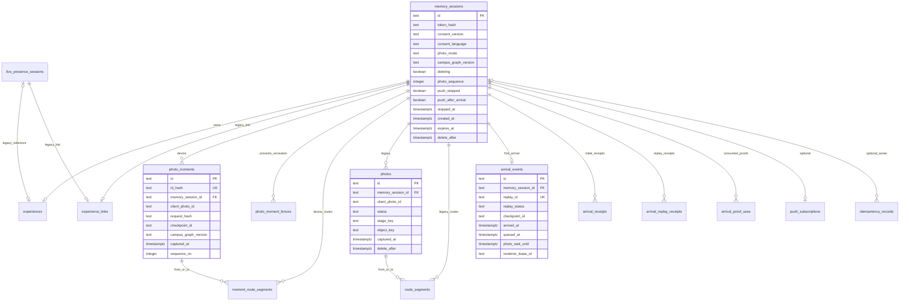

# データモデル（完成版）

更新日: 2026-11-06

Backend `6b87961`のmigration `001`〜`020`適用後の物理モデルを記録する。ここに記載したschemaが実環境へ適用済みという意味ではない。旧論理案のPhotoAsset、PhotoHotspotBucket、CampusNode等を実在テーブルとして扱わない。

## 方針

- PostgreSQL 17をサーバーの正本とし、新規device写真の画像本体は参加端末にだけ保存する。
- Memoryと旧Liveは別ID・別token hash・別同意・別期限。新規Liveは発行しない。既存の本人照会・停止・削除は維持する。
- `expires_at`は参加／新規操作の期限、`delete_after`は本人閲覧・自己削除の期限とサーバー保存削除期限。停止・到着・再視聴で書き換えない。
- 新規deviceと旧legacyは`memory_sessions.photo_mode`で固定する。既存行のmigration既定値はlegacy。device写真metadataを旧GCS写真の行へ入れない。
- セッション・写真等は不透明なtext ID。例外として旧Liveの`display_id`はmigration 007のUUID。監査IDはDB生成bigint。日時はTIMESTAMPTZ。
- 参加者の氏名・学籍番号・メールは収集しない。運営本人認証ではGoogle subjectと正規化メール由来の照合hashを持つ。hashを完全匿名化と呼ばない。

## ER図

以下は**実在テーブルの主要FKだけ**を示す。列は説明に必要な抜粋で、完全DDLはmigrationを正とする。写真のdevice／legacy混在、架空の独立photo_assets、DBにないGraph表を描かない。

optional ownerのidempotencyはMemory削除receipt等の全行がMemory FKを持つわけではない。`moment_route_segments`と`route_segments`の終端写真FKはnullableで、nullは到着終端に使う。GraphへのFKや`arrival_event_id`列を追加した図ではない。

## MemorySession

物理表は`memory_sessions`。status列やdisplay_alias列はない。APIの`main`／`arrived`／`ended`は停止・期限・到着の有無から求める。`consent_version`と`consent_language`、作成時刻、token hash、期限を保存する。

| 列 | 意味／追加migration |
|---|---|
| `deleting` | 003。旧画像消去中の書込み／閲覧フェンス。本人期限を延長しない |
| `photo_sequence` | 003。写真受付の単調なsequence発行に使用 |
| `push_stopped` | 005。参加停止・従来到着等で確定する終端通知停止。解除しない |
| `campus_graph_version` | 009。新規受付時に固定。旧セッションはnullの場合がある |
| `photo_mode` | 010。legacy／device。既存行をdeviceへ移行しない |
| `stopped_at` | 017。参加停止の最初の時刻、再開なし |
| `push_after_arrival` | 020。既定false。継続用の新同意版と一致する新Memoryだけtrue |

`push_after_arrival`は同意方針であり通知許可・購読そのものではない。migrationや設定後付けで旧Memoryをtrueへ変えず、期限・同意・本人資格・`push_stopped`も変更しない。

## Experience・ExperienceLink・旧Live

| 物理表 | 列・関係 |
|---|---|
| `experiences` | text ID、unique Memory FK（CASCADE）、nullable unique Live FK（SET NULL）、旧display_color／symbol、created_at／expires_at／delete_after |
| `experience_links` | text ID、unique Memory／Live FK（CASCADE）、token_hash、`token_expires_at`、関係の`expires_at` |
| `live_presence_sessions` | token_hash、consent_version、旧on_site_consent_version、tracking_status、presence_phase、stop_reason、旧表示色・記号、display_id UUID、created／stopped／last_seen／expires／delete_after |

新規MemoryにもExperienceは作るが、Live／link／aliasをAPIへ新規発行しない。旧リンク資格の期限と、本人状態に必要な関係の期限は別。migration 002は関係を両Sessionの早いdelete_afterまで保持する。片側削除でlinkを除去する。

旧Liveのtracking_statusはtracking／stopped／expired、presence_phaseはapproaching／arrived／on_site／endedがschemaに残るが、新規GPS・on_site継続は無効。Live自身のBearerはMemory削除後もLiveのdelete_afterまで照会・停止・削除できる。

## device写真metadataと経路

`photo_moments`には上図の9列だけを持ち、画像バイト、画像hash、容量、寸法、EXIF、GPS、object key、upload statusを持たない。`id_hash`と`request_hash`は画像のhashではなく、ID検索・登録入力の照合用。`(memory_session_id,client_photo_id)`と`(memory_session_id,sequence_no)`はunique。一覧はcaptured_at／sequence_no順で、受付順と撮影時刻を区別する。

`photo_moment_fences`はMemory FKとclient_photo_idの複合PK。写真個別削除後に古い送信で同じclient IDが復活するのを防ぎ、Memory削除時にCASCADEする。画像やチェックポイントを残す表ではない。

`moment_route_segments`はid、Memory FK、開始写真FK、任意の終端写真FK、coordinate／Graph／3D Map版、algorithm_version、confidence、path(JSONB)、path_node_ids(JSONB)、length_mを持つ。開始／終端写真は`photo_moments`を参照し、CASCADE。device経路は`checkpoint-dijkstra-1`。最後の写真→到着はto_photo_moment_id=nullで、到着表のcheckpoint_id／arrived_atから生成する。再視聴のqueued_atを経路終端時刻にしない。

追加・削除と経路再構成を同transactionで行う。本人memory GETはREPEATABLE READ・read onlyの同一snapshotで写真と経路を読み、途中の写真変更・期限削除による異時点混在を避ける。

## 旧PhotoMoment・PhotoAssetに相当する物理保存

旧画像は単一の`photos`行で管理し、独立した`photo_assets`表はない。003の列はID／id_hash、Memory FK（ON DELETE RESTRICT）、client ID、request hash、captured／created／delete_after／upload_expires_at、任意GPS4列、MIME／sha256／size／width／height、sequence_no、upload_attempts、status、stage_key／object_key、failure_code／delete_target。008で任意checkpoint_id／campus_graph_versionを追加した。

statusはpending／ready／failed／deleting。新規device構成ではこれらのupload状態へ遷移する写真を作らないが、旧画像消去・失敗処理には必要。消去に失敗した画像を行ごと失わないため親FKはRESTRICT。Memoryのdeletingを確定して新しい閲覧・書込みを止め、GCS消去を確認してから行を消す。

`route_segments`は旧`photos`への開始／終端FK（CASCADE）を保ち、Memory FK、3種の版、algorithm_version、confidence、path、length_m、created_at、009追加のpath_node_idsを持つ。旧GPS由来区間のalgorithmは`photo-edges-dijkstra-1`。device経路表へ付け替えない。

`photo_upload_fences(object_key PK,not_before)`にはSession FKを付けない。未失効のgeneration-zero PUTで削除写真が復活しないようゼロバイトobjectを維持し、URL失効後にobjectと記録を消すoutbox。Memory削除後も清掃が必要なランダムkey・期限だけを持ち、画像・GPS・写真FKを残さない。

旧写真外部I/Oは既存の単一インスタンス実装でSession／object fenceのadvisory lockとcontext期限を用いる。新規device metadataにGCS処理を追加しない。

## ArrivalEvent

`arrival_events`はMemory FKをuniqueにして初回到着を1行に限定する。sourceはqr。rootの`id`／`arrived_at`／`checkpoint_id`と、現在の公開`replay_id`／`queued_at`を分ける。再視聴や運営障害retryで行を増やさず後者と再生状態を更新する。

- replay_status: queued／playing／completed／skipped。
- photo_wait_until、replay_started_at、replay_finished_at、renderer_lease_id、skip_reasonを保存する。
- migration 013でreplay_deadlineを削除し、全体1 playingの部分unique indexを追加。通常待機30秒skipは現行仕様ではない。
- 019でreplay_id／queued_atをNOT NULLとし、旧行をid／arrived_atでbackfill。queued indexはqueued_at,id順。
- skip_reasonのschemaには過去互換値も残る。列のenum候補だけから現在の待機期限・queue-full skipを推定しない。

## 冪等性・proof・描画用の実在表

| 表 | 主な列と保持 |
|---|---|
| `idempotency_records` | scope＋key_hash複合PK、request_hash、response_status、response_body BYTEA、expires_at、任意Memory FK。一般操作は最大24時間。Memory所有分はdelete_after以下・CASCADE |
| `arrival_receipts` | Memory＋key_hash複合PK、request_hash、response_body BYTEA、expires_at。初回到着の入力照合とroot locator。24時間 |
| `arrival_replay_receipts` | Memory＋key_hash複合PK、request_hash、response_body BYTEA。再視聴の成功応答をMemory削除まで保持、expires_at列なし |
| `arrival_proof_uses` | Memory＋proof_fingerprint複合PK。64文字SHA-256のみ。初回／再視聴を通じMemoryごと同proofの新規受理を1度に制限、Memory削除でCASCADE |
| `display_cursor` | singleton、last_id。状態mutationとsnapshotの切断面を直列化 |
| `display_events` | bigint id PK、kind、data JSONB、occurred_at。公開投影だけ、永続連番差分 |
| `display_primary_lease` | singleton、lease_id、holder_id、expires_at。接続と推測困難なlease IDでfenceする |
| `display_renderer_receipts` | event_id PK、lease_id、kind、arrival_id、result、created_at。renderer再送照合 |

描画のarrival_idは現在のreplay_id。初回root IDを使って新世代へフォールバックしない。差分dataにMemory ID、本人token、画像URL、raw proof、生GPSは入らない。`DISPLAY_CLIENT`や`LIVE_POSITION`は現行物理表ではない。display leaseは単一行であり、接続数はGoメモリの値である。

## PushSubscription・運営制御

`push_subscriptions`はMemory FKをPK（CASCADE）、endpoint_encrypted／keys_encrypted BYTEA、interval_minutes、status、next_send_at、expires_at。011以後intervalは30のみ。status activeならnext_send_at必須、pausedはnull。endpoint・鍵はAES-GCM暗号化し、VAPID秘密鍵と暗号化鍵を分ける。

| 表 | 内容 |
|---|---|
| `registration_control` | singleton、closed_at。永続受付停止 |
| `notification_control` | singleton、stopped_at。全購読消去と通知停止、再起動で解除しない |
| `display_fallback_control` | singleton、mode、switch_at、changed_at。modeはnormal／pending／fallback、pendingだけswitch_atあり |
| `operator_credentials` | id、unique token_hash、actor_id、email_hash、origin、role=operator、created_at／expires_at。最長2分 |
| `arrival_operator_audit` | identity bigint id、operator_id、operator_email_hash（旧行nullあり）、action、target_id_short、result、created_at。個人を後付けせず24時間清掃 |
| `schema_migrations` | migrationの連続適用履歴。起動・ready・各API・cleanupで対応する最終版との一致を確認 |

運営資格の生token、Google token、生メール、subはDBに保存しない。描画用displayTokenは独立署名資格で、operator_credentials行として保存しない。

## CampusNode・CampusEdge・座標

固定GraphはBackendの`internal/route/campus_graph.json`とFrontendの`models/trace/campus_graph.json`に同梱する。DBのcampus_nodes／campus_edges表や動的ホットスポット表はない。Graphのnode／edge・3D Mapの互換版と変換は[座標仕様](coordinate-mapping.md)を参照。

migration 002でlive_positions表を削除。旧Liveの最新位置はGoプロセスメモリのTTL清掃対象で、新規書込み・公開描画への投影は行わない。DBに新規位置履歴を作らない。

## 端末データ

FrontendのIndexedDB名は`trace-ping-log`、version 2、object storeは`entries`（keyPath=id）。レコードのschema version 3は別概念で、自己申告placeを持ち、新規位置fixを入れない。LogEntryはrecord、JPEG Blob、sentAt、任意memorySessionId／photoMomentId等。photoMomentIdの未設定はmetadata送信前、nullは到着後撮影などで送信対象外。

同端末の旧schema 1／2の精度・写真記録は閲覧・削除用に残り、新規GPS取得／再送は行わない。deviceId等が端末型にあることをGoが収集する仕様に読み替えない。写真は上限12枚・30MiB、サーバー送信成功でも画像を消さず本人の作品に使う。ブラウザ消去・端末故障に対するサーバー画像バックアップはない。

## 削除

1. 参加期限到来は新規操作・描画・通知を終えるが、本人閲覧・削除資格はdelete_afterまで維持する。停止も期限を変更しない。
2. Memory個別削除はdevice metadata／経路／fence／到着／receipt／proof消費／Push等を所有関係に従って消す。旧画像はGCS消去確認を先行し、失敗時deletingで再試行する。
3. Live個別削除はMemory写真を消さない。Memory個別削除もLiveを消さない。ExperienceLinkは片側削除で除去する。
4. 一括削除は両資格を要求し、Live→Memoryを独立確定。部分成功receiptで未完了側だけ再試行する。Session削除用の短期receiptを所有FKで先に消して再送不能にしない。
5. 期限到来とcleanup成功は別。API起動時／30秒周期と別途cleanupコマンドの存在だけでは実削除済みと主張しない。旧GCS／upload fence・API／cleanupの権限を残す。
6. 端末写真・本人書出し画像・インフラログ／バックアップは別の保存範囲。サーバー削除だけで全端末画像が消えたとしない。

## 実装参照

- [migration一覧001〜020](https://github.com/Mino829/TRACE_B/tree/6b87961/internal/store/migrations)（特に002、003、008〜010、013、017〜020）
- [Memory停止・receipt期限](https://github.com/Mino829/TRACE_B/blob/6b87961/internal/store/memory_sessions.go)、[device写真・経路](https://github.com/Mino829/TRACE_B/blob/6b87961/internal/store/photo_moments.go)
- [初回到着](https://github.com/Mino829/TRACE_B/blob/6b87961/internal/store/arrivals.go)、[再視聴・proof消費](https://github.com/Mino829/TRACE_B/blob/6b87961/internal/store/arrival_replay.go)、[描画snapshot・lease](https://github.com/Mino829/TRACE_B/blob/6b87961/internal/store/display.go)
- [端末IndexedDB](https://github.com/Mino829/TRACE_F/blob/be94bd2/src/lib/ping-log/store.ts)、[端末レコード型](https://github.com/Mino829/TRACE_F/blob/be94bd2/src/lib/ping-log/record.ts)
