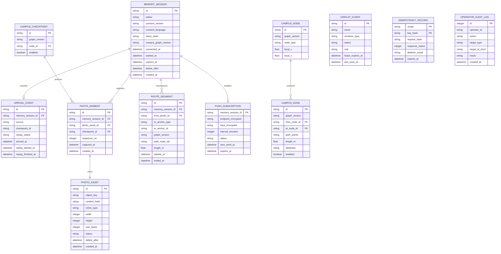

# データモデル

## 方針

- 本番の正本DBはMVPからマネージドPostgreSQLとする。Google CloudではCloud SQL、AWSではRDSを使用し、標準PostgreSQLの範囲を基本として移植性を保つ
- 写真バイト列はPostgreSQLへ入れず、非公開オブジェクトストレージへ保存する
- GPS（Geolocation API、撮影時位置取得）は使用しない。緯度経度・位置履歴のテーブルや列を新設しない。写真地点は参加者が3Dマップで選んだ`checkpointId`のみを保存し、座標・対応ノードIDの解決はBackendがCampusGraphから行う（2026-10-26決定、#23）
- セッションは`MemorySession`単独とする。`LivePresenceSession`は新規発行しない。旧Sessionは各`deleteAfter`まで照会・停止・削除可能な実データとして残し、前倒し削除しない（2026-10-26決定、#23、採用5）
- `ExperienceLink`、`display_alias`、`on_site_consent_version`は廃止した（2026-10-26決定、#23）
- 写真・チェックポイント地点・経路・削除冪等性記録は同一期間で一緒に消す（2026-10-26決定、#23）
- 個人名、学籍番号、メールアドレス、端末固有IDを保存しない
- 各セッションの`expires_at`（新規操作の期限）と`delete_after`（保存データの削除期限）を分離し、失効後も本人の読み取り・自己削除を`delete_after`まで許可する。開発側既定は`expires_at`=作成から6時間、`delete_after`=失効後24時間（2026-10-26決定、#23）。APIセキュリティログ30日・DBバックアップ最大7日は提案値であり、大学承認待ちである

## ER図

図中の`string id`は論理識別子の表記である。セッション、写真、経路等の識別子と参照先は既存の推測困難なプレフィックス付き不透明IDを維持し、PostgreSQLでは`text`型で揃える。UUIDv7や`uuid`型への変更は行わない。

`DISPLAY_CLIENT`は参加者データと関連付けない。描画機の接続監視だけに使用する。

`IDEMPOTENCY_RECORD`は到着、削除の重複適用を防ぐ。キーそのものではなくハッシュ、操作スコープ、リクエスト内容のハッシュ、返却結果、有効期限を最大24時間保存する。同じキーで異なる内容が来た場合は競合として拒否する。削除冪等性記録は写真・チェックポイント地点・経路と同一期間で一緒に消す。削除記録はID、資格情報、写真やセッション内容を含めず、削除状態を安全に再現できる短期receiptとする。

`OPERATOR_AUDIT_LOG`は受付停止、再生、skip、fallbackなどの運営操作を記録する。位置情報、参加トークンを含めず、対象IDも運営上必要な短縮表現にする。

### 廃止エンティティ

`LivePresenceSession`、`LivePosition`、`ExperienceLink`、`display_alias`、`on_site_consent_version`、`PhotoHotspotBucket`、写真の緯度経度列・`location_source`・`snapped_edge_id`・信頼度列は廃止した（2026-10-26決定、#23）。既存環境に残る旧テーブル・旧列は新規書き込みを行わず、旧Sessionの照会・停止・削除と各`deleteAfter`までの期限清掃のみに使う実データ契約とする（#23採用5）。旧GPSデータは`deleteAfter`まで保持し、前倒し削除しない。

## PostgreSQL実装規約

- セッション、写真、経路等のdomain entityの主キー・参照列は既存のプレフィックス付き不透明な`text` IDを保持する。UUIDv7への一括変更はせず、同じIDを使う外部キーの型も`text`で合わせる
- 外部へ公開しない追加の連番が必要な監査・集計テーブルだけ、`bigint generated always as identity`を使用できる
- すべての時刻列は`timestamp with time zone`としてUTCで保存する
- 状態値は`text`と`check`制約を基本とし、アプリだけでなくDBでも未知の状態を拒否する
- 外部キー列には参照・削除で使用するインデックスを作る。PostgreSQLは外部キー列のインデックスを自動作成しないため、migration reviewで漏れを検査する
- Goは上限付き接続プールを共有し、リクエストごとにDB接続を作らない
- migrationはGitで連番管理し、後方互換のあるexpand-contract方式で適用する。production起動時に破壊的migrationを自動実行しない
- 期限削除や写真処理を複数workerで実行する場合は、短いトランザクションと`FOR UPDATE SKIP LOCKED`でjobを取得することを原則とし、オブジェクトストレージのAPI呼び出し中にDB lockを保持しない。ただし、以下の開発者承認済みBackend #6の単一インスタンスMVP例外を適用する
- 日付partition、read replica、provider固有extensionはMVPで先行導入せず、実測した件数、query、VACUUM、復旧要件に基づいて判断する

### Backend #6の写真保存実装

対応PR適用後は、論理的なPhotoMomentとPhotoAssetを物理テーブル`photos`の1行で管理する。MemorySessionへの外部キーは`ON DELETE RESTRICT`とし、画像を消す前に親や削除先keyを失わない。`pending`/`ready`/`failed`/`deleting`状態、申告・検証対象メタデータ、`checkpoint_id`、stage/final object key、受付順とアップロード発行期限を持つ。撮影時刻順の取得と受付順の一意性は区別する。

`memory_sessions.deleting`は写真の新規登録・URL発行を止める内部的な削除フェンスであり、本人認証の`delete_after`を延長しない。無効画像は消去してから`failed`とし、object参照を落とす。削除対象の行はcloud消去成功後にだけ削除する。短期の冪等性記録には内容のハッシュと一方向の写真locatorだけを入れ、URL・画像・平文の写真IDを保持しない。

`photo_upload_fences`にはランダムなアップロード先keyと失効期限だけを保持し、MemorySessionへの外部キーは付けない。まだ有効なgeneration-zero PUTによる削除後の再作成を拒否するゼロバイトobjectの清掃記録である。写真完了・消去確定と同時にoutboxへ登録し、URL失効後にだけobjectと記録を消す。

### 開発者承認済みMVP例外：写真の外部I/Oと直列化

Backend #6では、写真完了・署名URL発行・消去・アップロードフェンス清掃に限り、PostgreSQL advisory lockを保持したまま必要なCloud Storage/IAM APIを呼び出す方式を開発者が選択・承認した。二重のDB/cloud更新と、消去中にフェンスが再作成されて追跡対象から外れる競合を、単純な直列化で防ぐためである。

ロック順はMemorySession→object fenceとし、フェンス清掃はobject fenceだけを取得する。取得後に状態・期限を再読込し、外部消去とoutbox完了を同じ直列化区間へ含める。外部I/Oは既存のAPI 10秒・定期清掃10秒・起動/清掃コマンド30秒のcontext deadlineで制限し、失敗時は永続化済み`deleting`/outboxから再試行する。

代償として外部I/O待ちがDB接続を占有する。最大1 APIインスタンス、既存の接続プール上限、受付停止の移行窓を維持し、実stagingで写真完了と削除の同時負荷・lock待ち・接続上限・期限超過と復旧を検証してから有効化する。複数APIへの拡張や負荷不成立時はこの例外を拡大せず、generation条件付き更新と処理claim/leaseによるロック外I/O方式を別途承認して移行する。

## MemorySession

写真、チェックポイント地点、経路、到着演出、本人用ストーリーを管理する単一のセッションである（2026-10-26決定、#23）。セッション作成時の`campus_graph_version`を記録し、写真地点の`checkpointId`の妥当性検証と経路再構成に使う（旧FR-035のGraph版記録を継承）。

- `status`: `main`（体験中）、`arrived`（到着済み）、`ended`（終了）。`on_site`概念は廃止
- `consent_version`: `2026-memory-photo-no-gps-draft-1`（jaのみ。enは大学審査後）。位置情報の項目を含まない
- `expires_at`後は写真登録などの新規操作を受け付けず、本人の状態・写真の閲覧と自己削除は`delete_after`まで許可する。開発側既定はTTL 6時間・`delete_after`失効後24時間

## 廃止エンティティ（旧Session読み取り契約）

旧`LivePresenceSession`は新規発行しない（2026-10-26決定、#23）。既存の旧Sessionは本人資格での状態照会・停止・削除と各`deleteAfter`までの期限清掃のみが有効である。`tracking_status`は`tracking`、`stopped`、`expired`のまま。旧GPSデータ（旧描画位置イベント・写真の緯度経度列を含む）は読み取り契約のみ（TRACE_B#30）で、前倒し削除せず`deleteAfter`まで保持する。`ExperienceLink`・`display_alias`・`on_site_consent_version`は廃止し、新規の関連付け・照合表示は行わない。セッションはMemorySession単独である。

## ArrivalEvent

到着はセッションにつき最大1件とする。二重送信は同じ結果を返す。

- `source`: `qr`、`operator`
- `replay_status`: `queued`、`playing`、`completed`、`skipped`
- `checkpoint_id`: 到着場所（ShibaLab）の識別子。署名付き証明そのものは保存しない
- `skip_reason`: `participant_request`、`timeout`、`renderer_failure`、`operator`

到着は展示ブースで投影・定期更新する署名・期限付きQRのBackend検証でのみ成立する（2026-10-26決定、#11）。受付ではMemorySessionへArrivalEventを作成し、`status`を`arrived`へ変更して撮影通知を停止する。写真0枚・1枚でも到着は成立する（2026-10-26決定、#23）。再生状態はArrivalEventだけを正とし、MemorySessionへ`replaying`を重複保存しない。

## PhotoMoment・PhotoAsset

`PhotoMoment`は参加者が残した撮影イベント、`PhotoAsset`は非公開オブジェクトストレージ上の加工済み画像を表す。写真EXIFは保存せず、撮影時GPSは取得しない。写真地点は参加者が3Dマップで選んだ`checkpointId`のみであり、必須である（未選択不可、現行実装準拠、TRACE_F#45）。

| 項目 | 内容 |
|---|---|
| `sequence_no` | セッション内の撮影順。unique |
| `checkpoint_id` | 参加者が選んだ写真地点。`CAMPUS_CHECKPOINT`参照。必須。座標・ノードIDはBackendがCampusGraphから解決し、写真行へは地点IDのみ保存する（旧FR-035のGraph版記録はMemorySession側で継承） |
| `object_key` | 推測困難な非公開オブジェクトキー。URLではない |
| `content_hash` | アップロード重複・破損検出用。公開しない |
| `status` | `pending`、`ready`、`failed`、`deleting` |
| `delete_after` | セッション削除期限以下。独立して延長しない |

写真は1セッション12枚までを暫定上限とする。原画像をそのまま保存せず、向き補正、EXIF除去、長辺1920px以下への縮小、再エンコード後の画像だけを保存する。写真単位削除では、PhotoMoment、PhotoAssetを削除し、前後のRouteSegmentを残った地点から再生成または未確定にする。写真ピン・個別ピン保護閾値・量子化・セッション固定オフセット・平滑化は廃止した（2026-10-26決定、#23）。

## RouteSegment

前の写真から次の写真、または最後の写真からShibaLab（到着）までの再構成経路。写真を撮った順に各写真の地点（チェックポイント）をCampusGraph最短経路でつなぐ。

- `from_photo_id`: 区間開始のPhotoMoment
- `to_anchor_type`: `photo`または`arrival`
- `to_anchor_id`: 次のPhotoMomentまたはArrivalEvent
- `graph_version`: 使用したCampusGraphの版
- `path_node_ids`: グラフの点IDの並び。生緯度経路を含めない
- `length_m`: 区間長。再生時間の比例配分に使う

生成時の入力は区間両端の写真地点（`checkpoint_id`）だけである。同じ入力と`graph_version`から再生成できるよう、経路生成アルゴリズムの版も設定またはメタデータへ記録する。再生は全体10〜20秒で区間の長さに比例配分し、写真地点で少し停止する。撮影時刻間隔の比例配分は使わない。信頼度・確からしさ表現は廃止した（2026-10-26決定、#23）。

## PushSubscription

MemorySessionに紐づく任意参加の撮影リマインダー。30分ごとのリマインダーのみを継続し、精度テスト用10分通知は廃止した（2026-10-26決定、#23）。ブラウザの購読エンドポイントと鍵は暗号化し、通知本文に写真、参加記号、経路を含めない。到着、停止、購読解除、期限切れの最も早い時点で無効化・削除する。通知時刻は厳密な保証をせず、端末内タイマーを補助表示として使える。購読情報の配置（D1維持 vs Go移管）はTRACE_B#12で未決であり、決定として扱わない。

## CampusNode・CampusEdge・CampusCheckpoint

キャンパス内の歩行可能経路を表すバージョン付きグラフ。CampusEdgeは距離、屋内外、階段、スロープ、エレベーター、利用時間、通行止め、バリアフリー可否を属性として持つ。公開中のグラフを直接上書きせず、新しい版を検証してから切り替える。`CAMPUS_CHECKPOINT`は写真地点・到着QRの候補地点であり、`node_id`でグラフ上の点を指す。チェックポイント一覧の粒度は未決である（実装PRは82点、ポケモンGO風8か所スポット案の採否含む。Mino829/TRACE_F#38）。決定として扱わない。

## インデックス

- `memory_sessions(delete_after)`
- `memory_sessions(status, expires_at)`
- `arrival_events(replay_status, arrived_at)`
- `photos(memory_session_id, sequence_no)` unique
- `photos(checkpoint_id)`
- `route_segments(memory_session_id, started_at)`
- `push_subscriptions(status, next_send_at)`
- `campus_nodes(graph_version)`
- `campus_edges(graph_version, enabled)`
- `campus_checkpoints(graph_version, enabled)`
- `display_clients(last_seen_at)`
- `idempotency_records(scope, key_hash)` unique
- `idempotency_records(expires_at)`
- `operator_audit_logs(created_at)`

実装時は、期限・queue走査のqueryに合わせて次の部分インデックスを優先する。

- `photos(delete_after) where status in ('pending', 'deleting')`
- `arrival_events(arrived_at) where replay_status = 'queued'`
- `push_subscriptions(next_send_at) where status = 'active'`
- `memory_sessions(delete_after) where delete_after is not null`

同じ列へfull indexとpartial indexを重複して作らず、`EXPLAIN`と実測で採用する索引を決める。

## 削除

1. MemorySessionの`expires_at`到来時は新規写真登録・URL発行を拒否する。状態照会と自己削除用の資格は`delete_after`まで保持する
2. `delete_after`到来時は、写真・チェックポイント地点・経路・到着イベント・PushSubscription・削除冪等性記録・トークンハッシュを削除対象にする。同一期間で一緒に消す（2026-10-26決定、#23）
3. 非公開オブジェクトストレージ上の写真を削除し、成功を確認する
4. DBレコードをトランザクション内で削除する。オブジェクト削除失敗時は`deleting`として再試行し、期限超過をアラートする
5. 旧LivePresenceSessionは新規発行しない。既存の旧Sessionは各`deleteAfter`まで照会・停止・削除と期限清掃のみを行い、旧GPSデータは前倒し削除しない（#23採用5）
6. 個人を復元できない集計値だけを残す場合は、大学への説明と同意文へ明記する

インフラのセキュリティログとバックアップはDB削除と同時に個別レコードを消せない場合があるため、原則として位置情報を含めず、別途定めた短い保持期限で世代ごと削除する。APIセキュリティログ30日・DBバックアップ最大7日は提案値であり、大学承認待ちである。
