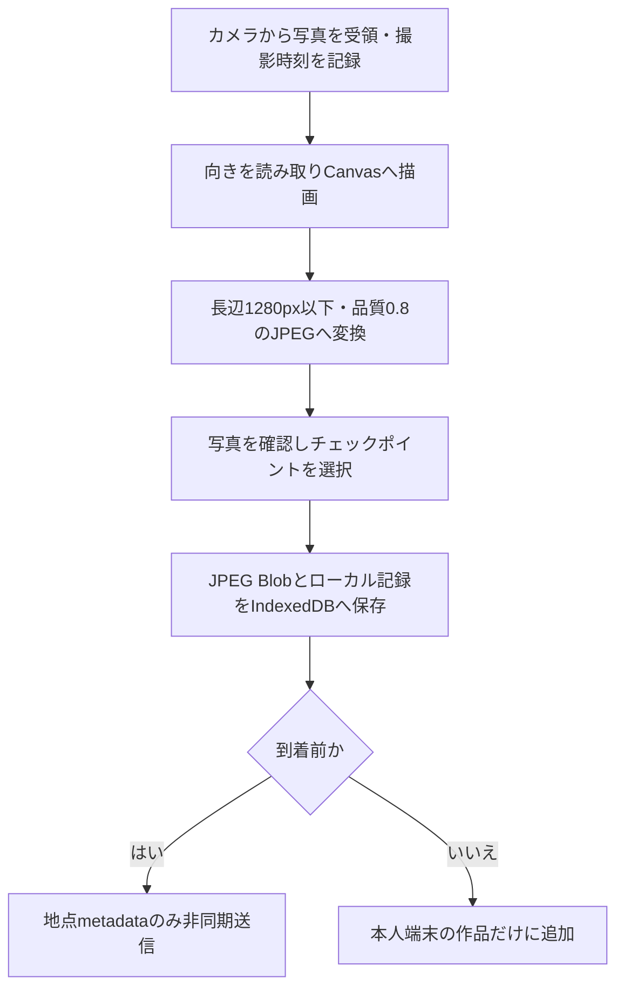

# 写真メモリー・経路再構成仕様（完成版）

更新日: 2026-11-06

## 目的

参加者が写真に残した瞬間と、自分で選んだ撮影場所を、キャンパスの光の経路として振り返る。写真そのものは本人端末にのみ保存し、地点・撮影時刻等のmetadataだけをGo Backendへ送る。GPSの新規取得・送信、写真の新規GCS保存、写真ピン・フォトスポットは行わない。

経路は自己申告チェックポイントを固定Graphで結んだ再構成であり、実際に歩いた道・速度・滞在の測定結果ではない。

## 完成版の公開範囲

| 機能 | 完成仕様 |
|---|---|
| 撮影 | `/log`で撮影・確認し、撮影場所を建物・階・チェックポイントから選ぶ |
| 画像保存 | EXIFを引き継がない縮小JPEGを、端末IndexedDBへ保存 |
| サーバー送信 | 到着前の`clientPhotoId`、`checkpointId`、`capturedAt`のみ。本人Bearerと冪等性キーを使用 |
| 経路 | 固定CampusGraphの地点間を結ぶ。Sessionと写真のGraph版を固定 |
| 本人閲覧 | 到着前から「作品を見る」でローカル写真、振り返り3D、作品JPEGを表示 |
| 本人保存 | 作品JPEGと各写真を、本人操作の共有シートまたはダウンロードで端末へ保存 |
| 展示 | QRによる初回到着と、再生完了後の新QRによる本人再視聴。写真画像は投影しない |
| 削除 | 写真単位、または参加全体の削除。停止とは別操作 |
| 旧クラウド写真 | 期限内の本人閲覧・削除と清掃のみ維持。新規登録・upload-url・completeは停止 |

コードに機能があっても、実配備・公開承認・実機確認済みとはしない。現環境の受付・通知・清掃・クラウド状態は未確認であり、本書の更新で有効化・停止・削除は行っていない。

## 参加体験

1. Backend公開設定の同意本文・版・言語を読み、明示同意する
2. サーバーでMemorySessionが作成された後に撮影へ進む。Liveは作成しない
3. カメラから写真を受け取り、プレビューで確認・撮り直しを選ぶ
4. 写真の場所をチェックポイントから選び、端末内に追加する。GPS権限は要求しない
5. 到着前は地点metadataを別途送る。写真保存はmetadata受付を待たない
6. 任意の時点で「作品を見る」を開き、写真・振り返り3D・JPEGを見て保存する。到着・通知状態を変えずホームへ戻れる
7. 展示のQRを読むと初回到着を登録し、待機・再生状態を表示する
8. 再生完了後、有効な参加で新しいQRを読むと同じ写真の再視聴をFIFO末尾へ申し込める
9. 記録を残して参加を終了するか、写真単位・参加全体を削除する

写真0枚でも到着登録は可能だが、本人作品JPEGは生成できない。1枚なら本人作品を作れ、到着後のサーバー経路は写真地点からShibaLabまでを含む。2枚以上では撮影時刻順の写真地点間を結ぶ。到着後も有効な参加なら撮影を続けられるが、その写真は本人の端末作品だけに追加し、展示用metadataへ送らない。

## 撮影時の処理



- `preparePhoto`は元画像のEXIF位置を解析して記録せず、出力へ継承しない
- 撮影時刻`capturedAt`はカメラがファイルを返した時刻を使い、EXIF日時ではない
- ローカル記録には場所名、階、Graph版、元画像の寸法等の端末内項目もあるが、GoへのPOSTへは含めない
- IndexedDB保存に失敗した場合は写真追加完了にせず、場所選択へ戻してエラーを表示する
- 画像変換は端末処理であり、旧BackendのWebPデコード・GCS保存処理を新規写真へ適用しない

| 制限・値 | 完成実装 |
|---|---|
| Backend写真metadata件数 | Memoryあたり保持中12件まで |
| Frontend撮影上限 | 公開設定`photo.maxCount`を使用（既定のローカル上限12枚） |
| JPEG長辺 | 1280px以下 |
| JPEG品質 | 0.8 |
| 端末内写真の総量 | 公開設定`photo.maxLocalBytes`。現行は31,457,280 byte（30MiB） |
| 写真の送信サイズ | 新規画像を送らないため、旧5MBアップロード制限は対象外 |
| GPS取得待ち | 取得しない |
| 旧オフライン画像送信キュー30MB | 廃止。画像は送信待ちではなく端末内の本体として保存 |

ブラウザの容量不足・消去・OSのストレージ回収で写真を失う可能性がある。端末保存の永続性、他端末への同期、紛失した画像の復旧を保証しない。本人が作品・写真をOSへ保存して持ち帰る導線を用意する。

## 端末内画像とmetadataの境界

### 端末内

IndexedDB `trace-ping-log`の`entries`へJPEG Blobを保持する。画像の照合キーはローカルエントリID（`clientPhotoId`）で、同じブラウザのタブ間へ変更を通知する。参加資格と同意記録はlocalStorageに保持し、画像と資格を公開URLへ入れない。

### Go Backend

本人Bearer付き`POST /v2/memory-sessions/{id}/photos`は次の本文だけを受け付ける。

```json
{
  "clientPhotoId": "端末写真のID",
  "checkpointId": "固定Graphの選択可能地点ID",
  "capturedAt": "ISO 8601形式の撮影時刻"
}
```

画像バイト列、画像ハッシュ、サイズ、座標、画像URL等の追加フィールドは拒否する。Backendは画像が端末へ実際に保存されたか・消えたかを検査できず、画像を復元できない。`checkpointId`は固定Graphに存在し、`selectable:true`の地点に限る。`role`だけでは選択可否を決めず、選択可能なwaypointも対象にできる。未選択・未知・非選択地点は`INVALID_CHECKPOINT`となる。

同一写真の再送は`photo:{clientPhotoId}`の同一キー・同一本文を使い、同じ記録へ収束する。本文変更によるキー再利用、同じclient IDへの異なる内容は競合となる。削除済みclient IDのfenceはMemoryの`deleteAfter`まで残し、遅延再送で復活させない。

### 通信失敗と画面上の意味

写真の「保存」はIndexedDBへの保存を指す。metadataの送信は別処理であり、通信不能時も写真と本人作品は残る。現行の写真UIはmetadataごとの通信待ち・拒否状態を表示しないため、写真保存完了を「展示に登録された」保証として説明しない。

画面再開・online復帰で未送信metadataを再試行し、429では`Retry-After`を待つ。Graph不一致・受付対象外等ではその写真が展示に反映されない場合がある。作品閲覧はこの送信完了を待たず、カメラや到着APIも起動しない。新規参加作成の通信失敗を端末だけの参加成功へフォールバックすることはない。

## キャンパス経路グラフ

FrontendとBackendは固定のCampusGraphを同梱する。チェックポイント、部屋、通路のwaypointをノードとし、屋外・屋内・橋・階段・エスカレーター・エレベーターを辺で結ぶ。場所選択画面は建物・階・選択可能地点を提示する。

| 版 | 同梱値 |
|---|---|
| `coordinateVersion` | `toyosu-2026-08-28.1` |
| `campusGraphVersion` | `toyosu-graph-2026-10-29.1.draft` |
| `threeDMapVersion` | `toyosu-3dmap-2026-10-30` |

`draft`は実装中の版名の一部であり、現地確認・正式承認済みを意味しない。Session作成時のGraph版を固定し、現在版と違うSessionへ新しい写真地点を追加しない。旧写真の同名IDを現行座標へ読み替えない。

## 経路再構成

### サーバーの展示・本人metadata経路

Goは受理したmetadataを`capturedAt`、同時刻の場合は`sequenceNo`の順に並べる。地点間は固定GraphのDijkstraによる経路とし、Backendでは通行可否・制限・閉鎖・時間条件を評価する。初回到着後は、最後の到着前写真から署名された到着地点ShibaLabまでを補う。到着後の端末追加写真はこの経路へ混ぜない。

本人の`GET /v2/.../memory`は写真metadataと`pathNodeIds`・Graph版を同じ読み取りスナップショットから返す。写真削除と経路の再構成は同じtransactionで行い、削除前の経路だけが残らないようにする。写真0枚は経路なし、1枚でも到着後の終端区間を返す。

### 本人端末の振り返り3D

`traceWay`はローカル写真のチェックポイントを同梱Graph上の最短経路で結び、到着前でもShibaLabを終端にする。Goへの到着照会・metadata取得を前提としない。Graph版違い・未知地点を経路のアンカーに使わない。写真は本人画面でのみ表示する。

これはGoの受理済み展示経路そのものの同期表示ではない。metadata未送信や到着後追加写真がある場合、本人作品と展示経路は一致しないことがある。また、端末側は同梱Graphの辺長による最短経路を組み立てるため、サーバーの時間条件付き経路選択と常に一致する保証はしない。精密な経路案内・バリアフリー案内として使用しない。

## 信頼度

新規写真では本人が地点を選ぶため、GPS精度円・吸着候補差・撮影間隔による`high/medium/low`の旧推定仕様は適用しない。Backendの経路形式に信頼度フィールドが残っていても、自己申告の真偽や実歩行の正確さの評価ではない。旧GPS由来写真の経路は旧本人閲覧・削除のため残る別系統である。

## 写真ストーリー

現行の本人画面の名称は「作品」。写真を持つ同じブラウザで、次を提供する。

- 撮影順の写真と撮影時刻
- 選んだ場所と、ShibaLabへ至る振り返り3D
- WebGLが使えない場合にも参照できる場所の一覧
- 写真を一枚にまとめた作品JPEG
- 作品JPEGと写真一枚ずつの保存、写真単位削除
- 保存期限と問い合わせ先（Backend公開設定）

iPhone/iPadは共有シート、Android/PCはダウンロードを使う。対応しない場合は画像長押しを案内する。共有シートの取消は保存成功と区別し、ブラウザからの受け渡しを写真アプリへの実保存確認とはしない。保存してもサーバー期限は延びない。本人が保存した作品・写真のコピーはアプリ内削除の対象ではない。

写真がない場合は作品を作れないことを表示する。他端末・他ブラウザへ写真を取りに行く機能や、クラウド画像で埋める機能はない。

## 公開スクリーンの表現

`/display`は受理済みmetadataのチェックポイント経路をthree.jsで再生する。画像・画像URLは描画通信へ含めない。写真の主要色をサーバーで解析して渡す処理や、写真を公開する同意機能はない。再生時間を全経路一律10〜20秒とする旧要件は採用しない。経路長・辺種別・描画側の再生設定で変わる。

初回到着は`/arrival`、再生完了後の新しい本人操作は`/arrival/replay`に分離する。再視聴は新しい公開再生IDでFIFO末尾へ入り、初回到着時刻・終端・Memory期限・既存の通知方針を変えない。待機・再生中の再読取は既存状態に合流し、追加予約や割込みはしない。停止・期限後・スキップ後は本人再視聴を受け付けない。

### リアルタイム写真ピン・フォトスポット

廃止済み。新規写真の場所を個別ピンとして即時公開したり、3件以上のbucketをフォトスポット化したりしない。旧TTL・量子化・少人数保護モードを現在のMust要件として残さない。

## 任意の撮影リマインダー

本番構成の通知はGo Web Pushで30分のみ。写真利用とは別の本人操作とブラウザ通知許可を必要とし、拒否・非対応でも参加できる。iOSではホーム画面Web Appが必要で、Safariタブからの参加は通知なしで続けられる。時刻はOS・ブラウザ・Push serviceの事情で遅れ、厳密な配信や重複なしを保証しない。

既存Memoryと通常の同意方針は到着で通知を停止する。到着後も続ける場合は、その用途・期限・解除方法を明示した**新しい同意版**と継続用設定が一致して作成された新規Memoryだけへ方針を固定する。既存参加・期限・同意を後付けで変更せず、消えた購読を復活させない。通知解除、参加停止、削除、期限、運営の全通知停止等で配信を止める。作品を見るだけでは停止・購読・再開を行わない。

旧独立`trace-push` Workerの補助経路は本番サイトの通知主体と混同しない。15分通知、開発者精度テストの新規購読は現行範囲外である。

## 写真の安全・プライバシー

- 他人の顔・名札・個人情報・授業資料・撮影禁止場所を写さないよう案内する
- 新規画像は端末だけに保存し、EXIFを引き継がない
- チェックポイント・時刻・参加資格を「匿名だから機微情報ではない」と扱わない
- ローカル資格が読める同じブラウザでは本人画面を開けるため、他人との端末共有に注意する
- カメラ利用は初回利用時、通知は任意の通知操作時に許可を求める。位置権限は要求しない
- 日本語・英語を切り替えても写真・資格を作り直さない。同意日本語正本と版別参考英訳を区別する

### 停止・削除・保存期限

| 操作・時点 | 写真・参加記録への影響 |
|---|---|
| 記録を残して参加を終了 | Memoryを終端化し、新規撮影・到着・再視聴・通知再購読を止める。写真と本人閲覧・削除を`deleteAfter`まで維持。再開不可 |
| 写真一枚を削除 | サーバーmetadataがあれば先に削除し、その後IndexedDB画像を削除。表示中の作品・経路を作り直す |
| 参加をやめる | サーバーMemory削除を先に確定し、資格・同意と端末写真を消す。通信失敗を完了表示にしない |
| `expiresAt` | 参加可能期限。記録の削除期限とは別 |
| `deleteAfter` | サーバー側保持・本人操作の期限。端末側は期限以降にアプリを開いたときの清掃対象 |
| アプリを閉じている間 | 端末写真の自動消去は保証しない。Backendの清掃だけで端末内画像は消えない |
| 保存したJPEG・写真 | OS側へ保存した本人のコピーは残る。アプリは削除できない |

写真削除では送信ロックを使い、途中のmetadata送信が写真を復活させない。通信不明のmetadataは本人一覧で照合してから削除する。サーバーに記録がない／資格保持が終了したことを示す401・404等の場合はローカルだけの削除へ進めるが、一般の通信失敗は削除成功として隠さない。

旧GCS写真は新規登録を止めても、本人閲覧・削除、既存`deleteAfter`、発行済みPUTのfence/outbox清掃を維持する。会期終了だけで旧写真を前倒し削除したり、GCS権限を外したりしない。

## 障害時

| 状況 | 現行の扱い |
|---|---|
| Backend設定取得・参加作成失敗 | 参加開始にせずエラー。端末だけの偽参加を作らない |
| カメラ拒否・画像変換失敗 | 設定・再試行を案内し、撮影追加を完了にしない |
| IndexedDB保存失敗 | 写真を追加済みにせずエラーを表示 |
| metadata送信失敗 | 端末写真は残す。送信可能時に再試行するが展示反映は保証しない |
| Graph版違い・未知地点 | 新しい座標へ読み替えず、解決できない地点として扱う |
| 本人作品の生成・保存失敗 | 生成エラーまたは長押し保存案内。写真をクラウドへ逃がさない |
| 到着QR・再視聴失敗 | 到着成功・新規予約と見なさず、現在のQRで再試行。外部QR失敗でカメラを自動起動しない |
| 停止・削除失敗 | 完了にせず本人が再試行できる状態を残す |
| ブラウザデータ消去 | 画像復旧不可。同じブラウザでの保存を案内し、端末間同期を約束しない |

## 実装根拠

- [写真縮小・JPEG再エンコード](https://github.com/Mino829/TRACE_F/blob/be94bd2/src/lib/ping-log/photo.ts)、[ローカル写真記録](https://github.com/Mino829/TRACE_F/blob/be94bd2/src/lib/ping-log/photo-entry.ts)、[IndexedDB](https://github.com/Mino829/TRACE_F/blob/be94bd2/src/lib/ping-log/store.ts)
- [撮影確認・場所選択](https://github.com/Mino829/TRACE_F/blob/be94bd2/src/components/ping-log/ray/photo.tsx)
- [metadata送信・到着後写真・停止・削除・期限処理](https://github.com/Mino829/TRACE_F/blob/be94bd2/src/components/ping-log/ping-log-screen.tsx)
- [本人作品](https://github.com/Mino829/TRACE_F/blob/be94bd2/src/components/ping-log/ray/keepsake.tsx)、[振り返り経路](https://github.com/Mino829/TRACE_F/blob/be94bd2/src/lib/ray/trace-scene.ts)、[画像保存](https://github.com/Mino829/TRACE_F/blob/be94bd2/src/lib/ping-log/save-image.ts)
- [Go metadata・削除・経路再構成](https://github.com/Mino829/TRACE_B/blob/6b87961/internal/store/photo_moments.go)、[固定Graphの経路処理](https://github.com/Mino829/TRACE_B/blob/6b87961/internal/route/route.go)
- [Backend README — 旧画像の保持・Push方針・再視聴](https://github.com/Mino829/TRACE_B/blob/6b87961/README.md)

実機試験、配信・保存成功率、会期実績、現在の清掃完了は本改訂では確認していない。
