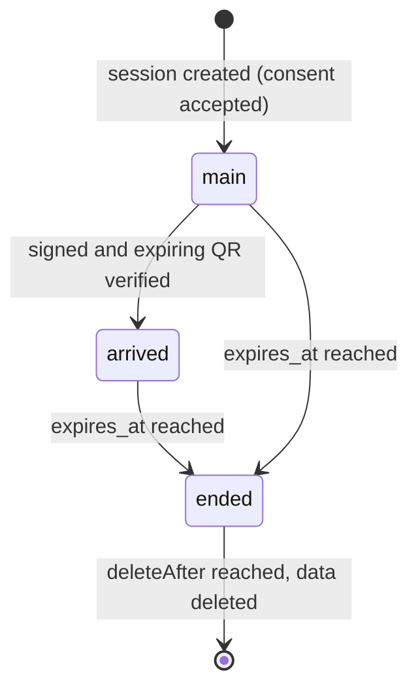
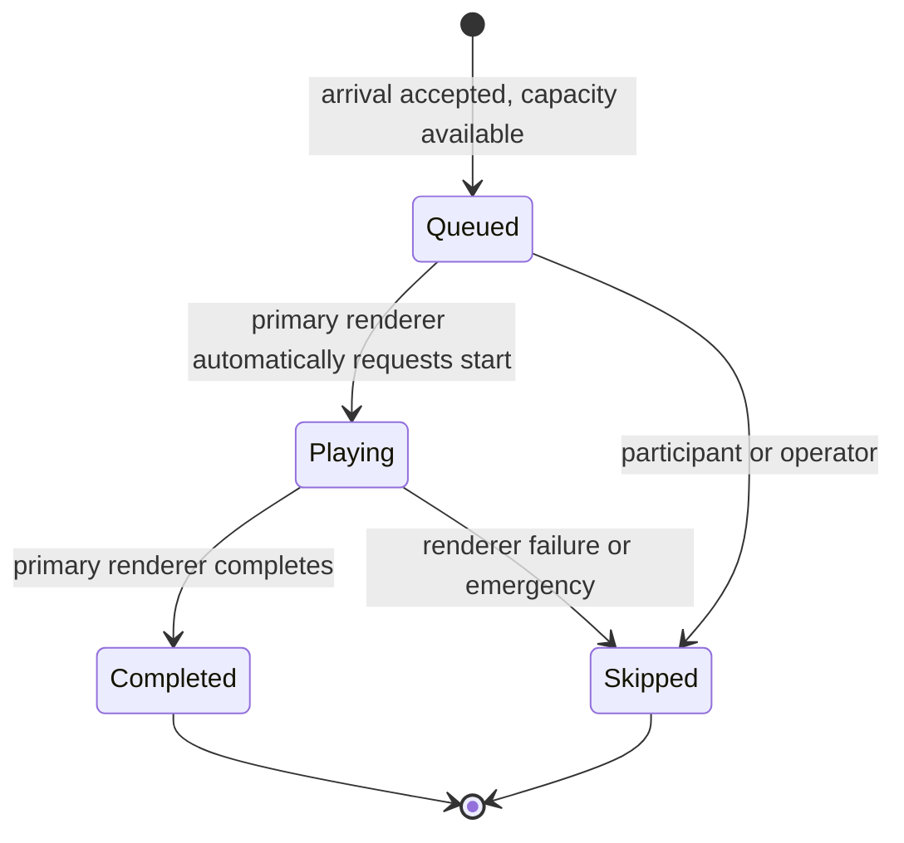

# セッション・到着演出の状態遷移

## 分離方針

体験は`MemorySession`単独で管理する。`LivePresenceSession`の状態機械は廃止した（2026-10-26、#23）。GPSは使用せず、位置による状態遷移は存在しない。写真地点は参加者が3Dマップで選んだ`checkpointId`のみである。

- `MemorySession.status`: 体験中、到着済み、終了のどこか
- `PhotoMoment`: 新規方式は写真メタデータを受理時に確定する。画像の送信・検証状態はサーバーに存在しない（移行前の`PhotoAsset.status`だけ別に維持）
- `ArrivalEvent.replay_status`: 到着演出がどこまで進んだか

通信切断は永続状態にしない。`last_seen_at`から運営画面が`degraded`と判定し、再接続時は有効期限内の同じセッションを継続する。`MemorySession`は`expires_at`後に新規操作を受け付けない一方、本人の読み取り・自己削除は`delete_after`まで受け付ける。`expires_at`と`delete_after`を同一視しない。

## MemorySession状態

| 状態 | 内容 | 新規操作 |
|---|---|---:|
| `main` | 同意済みで体験中。写真撮影・地点申告・到着待ち | Yes |
| `arrived` | 到着証明を検証済み。撮影通知を停止 | 写真登録は可（失効前） |
| `ended` | 失効。完了状態・削除予定日時・ストーリー保存の表示のみ | No |

| 現在 | イベント | 次 | サーバー処理 |
|---|---|---|---|
| - | `session.created` | `main` | トークン、`expires_at`（既定6時間）、`delete_after`（失効後24時間）を発行 |
| `main` | `arrival.accepted` | `arrived` | 署名・期限付きQRを検証し、ArrivalEventを作成、撮影通知を停止 |
| `main` | `session.expire` | `ended` | 新規操作を拒否。照会・自己削除は`delete_after`まで維持 |
| `arrived` | `session.expire` | `ended` | 同上 |
| `arrived` | `replay.completed` / `replay.skipped` | `arrived`（維持） | 演出状態はArrivalEventだけを正とし、`status`を上書きしない |

到着証明は展示ブースで投影・定期更新する署名・期限付きQRのBackend検証でのみ成立する（2026-10-26決定、#11）。期限切れ、改変、別会場の証明は拒否する。`on_site`概念は廃止した。削除は状態遷移ではなくデータ消去であり、[削除](#削除)を参照する。

## 写真メタデータと旧写真状態

新方式（未実装・承認待ち）では、Web Appが加工画像を同じブラウザのIndexedDBへ保存してから、写真ID・`checkpointId`・撮影時刻のみをBackendへ送る。端末の保存失敗時は撮影完了としない。通信断中はメタデータの再送待ちを端末内に持ち、再送時には同一`clientPhotoId`と冪等性キーを使う。サーバーが登録を受理した時点で`PhotoMoment`が確定し、`pending`や`ready`への画像アップロード状態遷移はない。Backendは端末画像の存在を確認できず、端末が消失した画像をサーバーから復元することもできない。

- 写真メタデータには有効な`checkpointId`が必須である。未選択・無効な地点は登録を拒否する。画像・画像URL・画像のハッシュ/寸法は受け付けない
- 写真単位削除では前後のRouteSegmentを無効化し、残った写真地点から再生成する。Backend側メタデータ削除とWeb App側画像削除の成否を別々に扱う
- 到着時に再送待ちの写真がある場合は、Backendが受理済みの写真だけで演出を生成し、未登録の写真を再生対象としない
- 旧`PhotoAsset`の`pending`→`ready`/`failed`→`deleting`は旧クラウド写真の本人閲覧・削除・各`deleteAfter`での清掃が完了するまで維持する。旧`pending`は画像のアップロード/検証待ち、`deleting`はオブジェクト消去待ちであり、新方式には適用しない

## 到着演出状態

| 状態 | 内容 |
|---|---|
| `queued` | 到着済み、再生待ち |
| `playing` | 主描画機が演出中 |
| `completed` | 正常終了 |
| `skipped` | 参加者選択、描画障害、運営操作で終了。通常の待機時間だけでは終了させない |

| 現在 | イベント | 次 | サーバー処理 |
|---|---|---|---|
| - | `participant.arrived` | `queued` | 到着証明を検証し、キューへ一度だけ追加 |
| `queued` | `replay.started` | `playing` | 到着順に自動送信された開始要求について主描画機リース・状態を検証し、開始時刻を記録する |
| `queued` | `replay.skipped` | `skipped` | 理由と終了時刻を記録 |
| `playing` | `replay.completed` | `completed` | 完了時刻を記録 |
| `playing` | `replay.failed` | `skipped` | 障害理由を記録し通常展示を継続 |
待機中の`queued`は先入れ先出しとし、通常の混雑では順番を待って再生する。30秒経過だけを理由にskipしない。有効なMemorySessionの待機上限は50件（`playing`を除く）で、満杯の新規到着は503の一時エラーとし到着・通知停止を確定しない。空きが戻れば有効QRで再試行する。同じセッションの再送は二重登録しない。MemorySessionの期限切れ・削除は待機を終了させる。Backend Draft PR #36がこの変更を実装し、#34/#35から積み上がっている。閉場時の整理と障害運用は別途確定する。

通常開始に運営者の操作は不要。主描画機は前の演出の完了確定後に終了画面を4秒表示し、その後に次の待機到着の開始を要求する。終了画面中は次を開始せず、待機がなければQR画面へ戻る。終了画面は描画機の表示状態であり、到着状態は`completed`のままとする。待機描画機は開始できず、完了済み・スキップ済みの到着を通常の自動開始へ戻さない。障害後の再試行は別途決定する。

`playing`中と終了画面中は到着QRを非表示にする。これは新規到着の拒否や発行済みQRの失効ではなく、有効なQRによる到着は非表示中も受け付けて順番を待つ。表示切替と終了画面の優先制御はFrontend側の設計目標で、現地検証は未実施。

再生データはグラフの点IDの並び（経路）+グラフ版+写真ごとの点IDと撮影時刻である。経路は写真を撮った順に各写真の地点をCampusGraph最短経路でつなぎ、最後の写真からShibaLab（到着）までの区間も同じ線で描く。再生は全体10〜20秒、区間の長さに比例配分、写真地点で少し停止する。

**写真0枚・1枚の到着**: 到着自体は写真枚数に依存せず成立する（2026-10-26決定、#23）。0枚・1枚のときは再生を簡易表示（スポット名や写真の有無の案内）に縮小し、経路再生または単一地点表示に落ち着かせる。到着とセッション終了を妨げない。2枚以上のときは写真地点を結ぶ経路再生を返す。

## 冪等性・競合制御

- 到着済みセッションへの本人認証済み再送はQRの期限に関わらず既存のArrivalEventを返す。投影QRの同一値は複数セッションで読めるため、証明そのものの一回限りの使用は保証しない
- 描画機からの同じ`eventId`は一度だけ適用する
- 到着作成はArrivalEvent作成と`status=arrived`更新を一つのDBトランザクションで行う
- 演出開始は主描画機リースを持つ一台だけが確定できる
- 終端状態から別の状態へ戻さない
- 版不一致の描画イベントは破棄し、直前互換版へ戻す（2026-10-26決定、#23）

## 削除

削除は状態遷移ではなくデータ消去である。`DELETE /v1/memory-sessions/{memorySessionId}`（単一資格情報、`Idempotency-Key`付き）でサーバーの写真メタデータ、チェックポイント地点、経路、到着イベント、Push購読、トークンハッシュを消す。Web Appは同じ参加の端末内画像とメタデータ再送待ちを別に消し、成功/失敗を分けて表示する。Backendの204は端末画像の削除を保証しない。旧写真を持つセッションではオブジェクト消去を確認し、失敗時は旧`deleting`として再試行する。同じキーによる安全な再送に限り、IDやトークン、写真を含まない24時間以内の短期削除記録から進捗を復元する。旧`DELETE /v1/experiences/{experienceId}`（両資格情報）は旧Session向けの読み取り/削除契約としてのみ残す。

## 異常系

- 描画機が接続されていない場合の待機・復旧・受付停止の扱いは未決。通常の混雑と機器障害を区別して公開前に決める
- 端末時刻が不正でも、到着はサーバー受信時刻とQRの署名・有効期限を正とする
- 主描画機が再生中に切断した場合は演出を`skipped`にし、同じ到着を別端末で自動再開しない
- 参加者が再生前に削除した場合はキューから除外し、描画機へ停止イベントを送る
