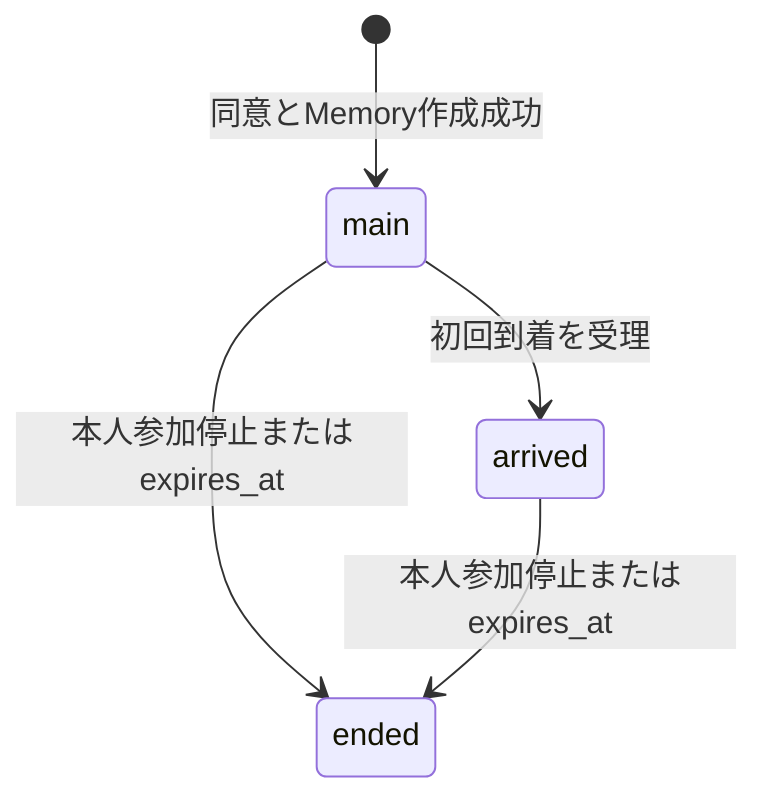
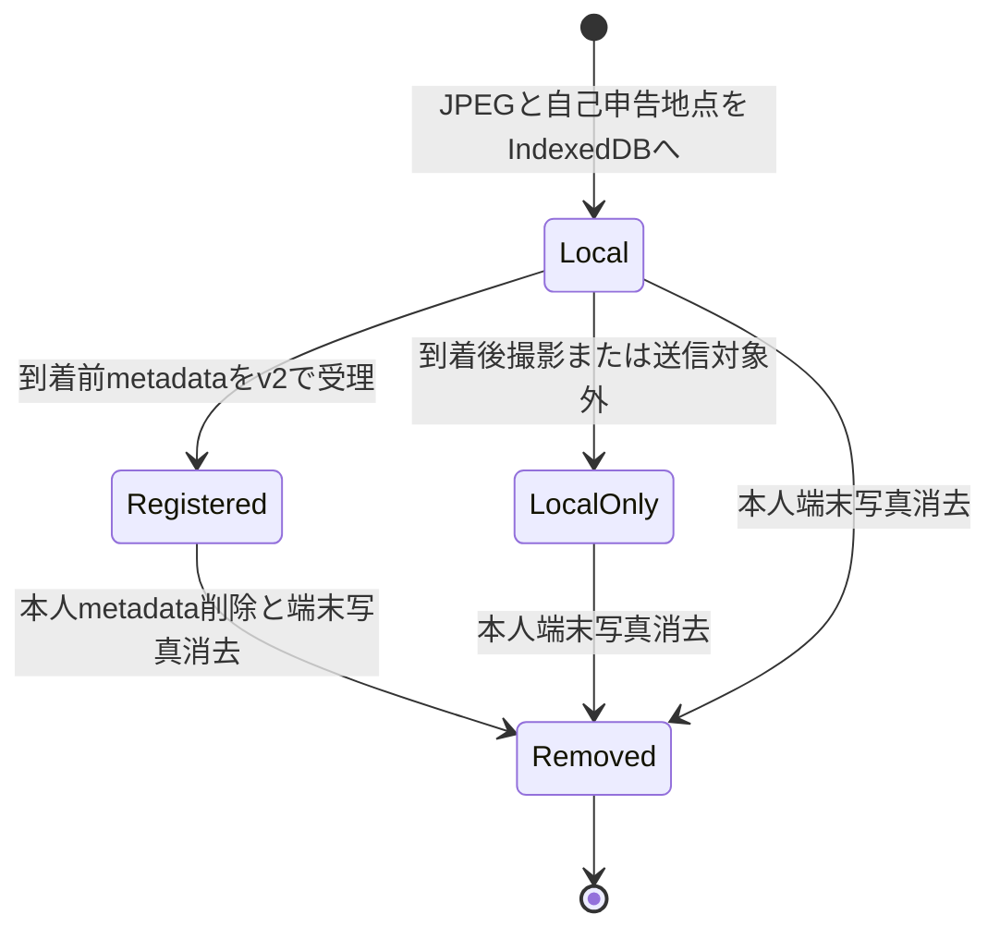
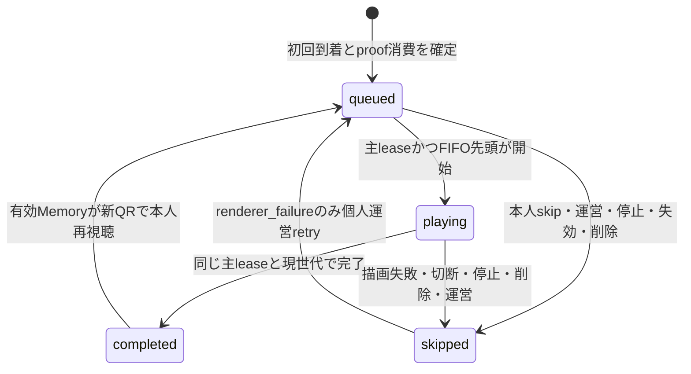
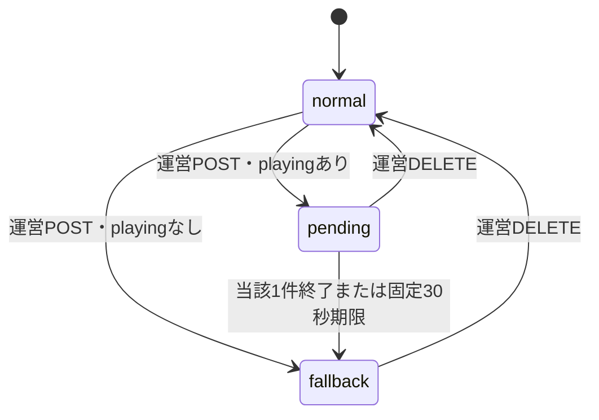

# 参加追跡・到着演出の状態遷移（完成版）

更新日: 2026-11-06

Backend `6b87961`（schema 20）／Frontend `be94bd2`に対応する。新規GPS追跡は廃止済み。Memory参加、到着の有無、再生世代、任意通知、旧Live、削除を別の状態として扱う。画面のローカル作品閲覧をサーバー到着と混同しない。

## 分離方針

| 関心 | 正本 |
|---|---|
| Memory参加 | memory_sessionsのstopped_at／expires_atとarrival_eventsの存在からAPI statusを導出 |
| 初回到着 | Memoryにつき1行のarrival_events。root id、arrived_at、checkpoint_idは再視聴で変更しない |
| 現在の展示再生 | arrival_eventsのreplay_id／queued_at／replay_status |
| 写真 | 新規は端末JPEG＋サーバーmetadata。旧GCSのupload状態はlegacyに限定 |
| 通知 | 作成時のpush_after_arrival、終端push_stopped、任意購読active／paused、運営停止 |
| 旧Live | tracking_status／presence_phaseは互換保存。新規位置受付・継続なし |
| 削除 | 永続データ・オブジェクト・端末画像の消去であり、単なるstatus変更ではない |

## Memory参加状態

`memory_sessions.status`列はない。未停止・参加期限内なら到着前main、到着後arrived、停止・失効後ended。演出completed／skippedだけではendedにしない。

| 操作 | 結果 |
|---|---|
| 「作品を見る」 | 到着前からローカル写真・3D経路・作品保存へ。参加／到着／再予約／通知を変更しない |
| 初回QR | 有効proofで初回到着を確定。Memoryをarrivedへ |
| 完了後の新QR | 同じMemory・写真で別再生世代を末尾へ予約。Memory statusはarrivedのまま |
| 本人参加停止 | 最初のstopped_atを固定。Push消去、queued／playingをparticipant_request skip、描画除外・fallback進行を同transactionで確定 |
| 参加期限 | 新規写真・初回到着・再視聴・購読等を拒否し描画から除外。本人閲覧・削除の期限は維持 |
| 通知だけ解除 | 参加終了ではない。終端停止がなければ再同意・再購読可能 |

停止後に同じMemoryを再開するAPIはない。`expiresAt`／`deleteAfter`を停止・到着・演出完了で短縮も延長もしない。`deleteAfter`到達後の本人認証は拒否するが、期限削除成功は別途確認が必要。端末内作品はサーバー資格の失効と同時に消えるわけではない。

## 写真状態

### 新規device写真

図は端末／サーバーをまたぐ業務状態で、DBのstatus値ではない。v2にはpending／ready／failed等のupload状態はない。端末写真の画像はサーバー送信成功でも残り、metadata再送だけを完了する。登録はclientPhotoIdと入力hashで集約し、削除後はfenceが古い再送による復活を防ぐ。

参加期限内なら到着後も端末で撮影できるが、Frontendは到着後写真metadataをGoへ追加送信しない。Backendの写真追加APIは到着だけを禁止条件にしないため、この画面方針とAPIの許可範囲は同一ではない。写真追加・削除と経路再構成はサーバー内で一体化し、到着後のmetadata変更イベントは現再生世代の全投影を置換する。

### 旧クラウド写真

legacyの`photos.status`はpending／ready／failed／deletingが残る。新規device構成ではuploadしない。旧画像の本人閲覧はreadyだけ、削除ではdeletingフェンスを確定し、GCS消去を確認してから行を消す。不正画像の消去失敗もdeletingから再試行して、消去後にfailedへ進む。署名PUTの有効期限後までupload fenceの清掃を維持する。旧写真の状態を新規端末写真の保存状態へ転用しない。

## 到着演出状態

completed→queuedと限定的なskipped→queuedは**新しいreplay_id・queued_atの世代**を作る操作であり、前世代の完了を巻き戻す操作ではない。同じ世代の終端へ遅れたrenderer messageが来ても状態を変更しない。

### 初回と本人再視聴

| 条件／処理 | 初回`arrival` | 本人`arrival/replay` |
|---|---|---|
| 初回未登録 | 有効・未停止Memory、有効proofが必要 | 対象外 |
| 既存到着 | 初回root IDと現在statusを返す。再enqueueしない | completedだけ新規受理 |
| proof | 新規初回でMemoryごと消費 | 新しい有効proofをMemoryごと消費。初回使用済みも再利用不可 |
| 成功 | root id=replay_id、arrived_at=queued_at | 新replay_id・現在queued_at、root到着と経路終端は固定 |
| 通知 | 作成時の同意方針に従う | 新たに止めたり復元したりしない |
| receipt再送 | 入力hash照合、応答は現在status | 保存済み同一成功応答、再enqueueなし |
| 終端・満杯 | 新規操作は確定しない | 同左。proof・receiptを消費しない |

proofは25秒。サーバー署名・用途・鍵ID・会場・地点・時刻を検証する。記録はMemoryとSHA-256 fingerprintだけで、生proofをDBへ保存しない。別Memoryによる同じQR利用は禁止しない。既存到着回復／受理済み再視聴receiptの再送はproof期限後も可能だが、新しい予約は有効proofが必要。

### FIFO

- 待機は有効なMemoryのqueuedを`queued_at,id`順に最大50件、playingは全体1件。
- 満杯は503＋Retry-After:5。初回到着／通知停止／旧Live更新／proof消費／receiptを部分的に確定しない。
- 旧pending写真がある先頭は最大15秒だけ開始待機し、後続は追い越さない。写真0枚・1枚でも到着可能。
- 通常待機の30秒timeoutは廃止。Memory自体の失効・停止・削除は除外する。
- 主描画機が自動で先頭の開始を要求し、Backendが先頭・lease・単一playing・fallback状態を検証する。運営の毎回手動playはない。
- 完了画面4秒・その間のQR非表示はFrontendの表示制御で、DB FIFOに4秒の待機状態を追加しない。

## 主描画機lease・再接続

専用OriginでGoogle由来displayTokenを取得し、直接WSSの最初の認証frame後にsnapshotを受信する。主leaseは30秒、10秒heartbeat等で更新。待機接続は受信できるが開始・完了を確定できない。

主機切断・lease失効では、そのleaseがplaying中の世代をrenderer_failure skipにする。別機へ同じ再生を自動引継ぎしない。個人運営者の明示retryだけが有効Memory・空き枠を確認して新しい公開再生IDで末尾へ並べ直す。旧世代のrenderer eventId／arrivalIdを新世代へ読み替えない。

接続直後・差分欠番・保持切れはsnapshotで全置換する。snapshotはcursorと到着／fallbackを同一transactionの切断面から取り、差分のDB連番と制御応答IDを区別する。通信断そのものをMemory参加停止にはしない。

## fallback

pendingでは新規開始を拒否し、現在の1件だけ待つ。30秒の固定期限は再送で延ばさず、期限時はその1件だけoperator skip。全モードで新規到着と待機列を保持する。再起動・再接続・新leaseでnormalへ戻さない。fallbackは受付停止／全通知停止ではない。

## 撮影通知

任意通知は30分のみ。購読active／pausedはMemory参加と独立だが、終端停止に優先できない。

- 新規Memory作成時だけ`push_after_arrival`を固定する。既存はfalse。継続は従来と異なる新しい同意版・本文を設定し、その版で作った新Memoryだけに適用する。
- falseは初回到着時にpush_stopped=true・購読削除・再購読禁止。trueは到着だけを理由に消去しないが、自動購読／復活もしない。
- 参加／旧Live停止、期限、Memory削除、本人解除、provider失効、全通知停止で削除。いったん終端化したpush_stoppedを解除しない。
- 単純購読解除は参加停止ではなく、許可条件を満たせば再購読できる。pausedは資格・鍵を保持する別状態。
- 運営全停止はDBに永続化し全購読を消す。provider受理済み通知の到着を取り消せるわけではない。

## 旧Liveの追跡状態・会場内フェーズ

tracking／stopped／expired、approaching／arrived／on_site／endedは旧schema・本人操作のために残る。新規Live作成なし。位置POSTは本人認証後410、on-site continue trueも410で、新規GPS受付を復活させない。

旧有効linkがある初回到着だけは、link資格を照合し、追跡中・来場前・期限内Liveをarrivedへ同transactionで更新する。停止済みLiveは再開しない。Live停止はstopped／endedにし位置キャッシュを消去するが、Memory写真を削除しない。旧Live自身のBearerによるGET／停止／削除はMemory削除後もLiveのdeleteAfterまで残す。

## 冪等性・競合制御

- 同じキーで異bodyは409。初回到着、再視聴、写真、停止、削除のscopeとreceipt保持を分離する（[API仕様](api.md#冪等性キー)）。
- 到着と再視聴はdisplay lease→queue→Memoryの順で直列化し、満杯・競合を副作用なしで返す。
- rendererのeventIdはlease・操作・現世代を照合し一度だけ適用する。旧世代や失効leaseをroot IDへ読み替えない。
- 写真削除・追加と経路再構成・公開投影を同transactionで確定する。部分的経路を実測として補完しない。

## 削除

削除は停止とは別。Memoryと旧Liveは個別資格で個別削除でき、一括削除だけは両資格を要求する。Live側を先に独立確定し、Memory失敗はpendingとして同じキーで未完了側だけ再試行する。片側を消したらlinkは除去するが他方を勝手に消さない。

旧画像の消去失敗はdeletingとfence/outboxで追跡し、完了前に対象keyを失わない。device metadataの削除、端末IndexedDBの画像消去、本人書出し画像、バックアップは別範囲。会期終了、expires_at、delete_afterだけから実清掃完了を推定しない。

## 実装参照

- [Memory停止](https://github.com/Mino829/TRACE_B/blob/6b87961/internal/store/memory_sessions.go)、[本人status／旧Live API](https://github.com/Mino829/TRACE_B/blob/6b87961/internal/api/server.go)
- [初回到着・FIFO](https://github.com/Mino829/TRACE_B/blob/6b87961/internal/store/arrivals.go)、[再視聴・proof消費](https://github.com/Mino829/TRACE_B/blob/6b87961/internal/store/arrival_replay.go)
- [主lease・再生世代検証](https://github.com/Mino829/TRACE_B/blob/6b87961/internal/store/display.go)、[停止／失効／運営retry](https://github.com/Mino829/TRACE_B/blob/6b87961/internal/store/display_lifecycle.go)、[fallback](https://github.com/Mino829/TRACE_B/blob/6b87961/internal/store/fallback.go)
- [schema 020通知方針](https://github.com/Mino829/TRACE_B/blob/6b87961/internal/store/migrations/020_push_after_arrival.sql)、[通知運用契約](https://github.com/Mino829/TRACE_B/blob/6b87961/README.md)
- [Frontend到着／作品閲覧](https://github.com/Mino829/TRACE_F/blob/be94bd2/src/components/ping-log/ray/arrival.tsx)、[到着後写真の端末限定保存](https://github.com/Mino829/TRACE_F/blob/be94bd2/src/components/ping-log/ping-log-screen.tsx)
