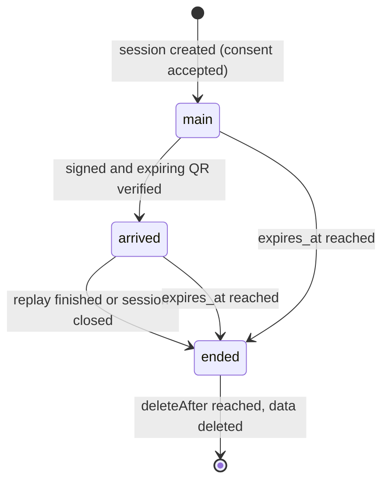
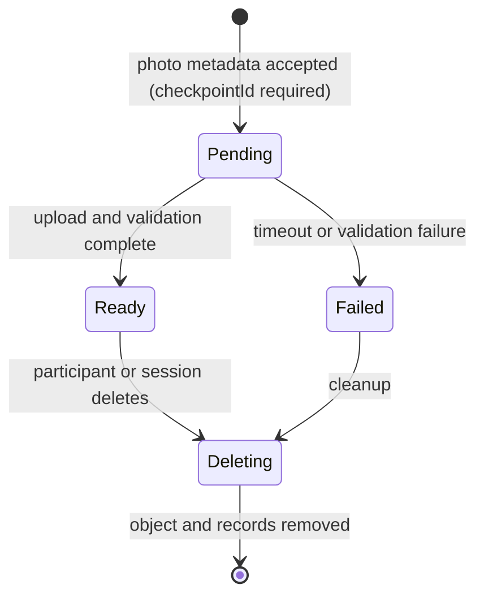
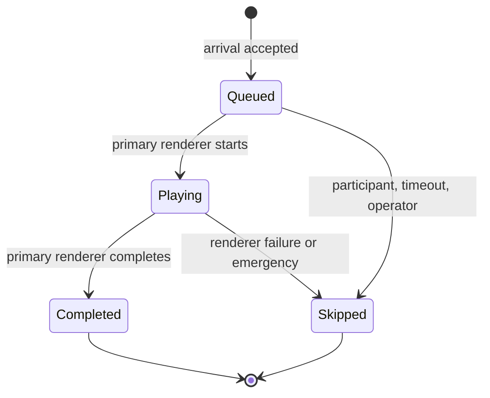

# セッション・到着演出の状態遷移

## 分離方針

体験は`MemorySession`単独で管理する。`LivePresenceSession`の状態機械は廃止した（2026-10-26、#23）。GPSは使用せず、位置による状態遷移は存在しない。写真地点は参加者が3Dマップで選んだ`checkpointId`のみである。

- `MemorySession.status`: 体験中、到着済み、終了のどこか
- `PhotoAsset.status`: 写真の送信・検証・削除状態
- `ArrivalEvent.replay_status`: 到着演出がどこまで進んだか

通信切断は永続状態にしない。`last_seen_at`から運営画面が`degraded`と判定し、再接続時は有効期限内の同じセッションを継続する。`MemorySession`は`expires_at`後に新規操作を受け付けない一方、本人の読み取り・自己削除は`delete_after`まで受け付ける。`expires_at`と`delete_after`を同一視しない。

## MemorySession状態

| 状態 | 内容 | 新規操作 |
|---|---|---:|
| `main` | 同意済みで体験中。写真撮影・地点申告・到着待ち | Yes |
| `arrived` | 到着証明を検証済み。撮影通知を停止 | 写真登録は可（失効前） |
| `ended` | 再生完了または失効。完了状態・削除予定日時・ストーリー保存の表示のみ | No |

| 現在 | イベント | 次 | サーバー処理 |
|---|---|---|---|
| - | `session.created` | `main` | トークン、`expires_at`（既定6時間）、`delete_after`（失効後24時間）を発行 |
| `main` | `arrival.accepted` | `arrived` | 署名・期限付きQRを検証し、ArrivalEventを作成、撮影通知を停止 |
| `main` | `session.expire` | `ended` | 新規操作を拒否。照会・自己削除は`delete_after`まで維持 |
| `arrived` | `session.expire` | `ended` | 同上 |
| `arrived` | `replay.completed` / `replay.skipped` | `arrived`（維持） | 演出状態はArrivalEventだけを正とし、`status`を上書きしない |

到着証明は展示ブースで投影・定期更新する署名・期限付きQRのBackend検証でのみ成立する（2026-10-26決定、#11）。期限切れ、改変、別会場の証明は拒否する。`on_site`概念は廃止した。削除は状態遷移ではなくデータ消去であり、[削除](#削除)を参照する。

## 写真状態

| 状態 | 内容 |
|---|---|
| `pending` | メタデータ作成済み、画像送信または検証待ち |
| `ready` | 非公開保存と検証が完了し、本人用ストーリーで利用可能 |
| `failed` | 送信期限切れ、形式・容量・EXIF検証失敗 |
| `deleting` | オブジェクトを削除中 |

- 写真メタデータには`checkpointId`が必須である。未選択・無効な地点は登録を拒否する（現行実装準拠、TRACE_F#45）
- 同じ`clientPhotoId`、ハッシュ、冪等性キーは一つのPhotoMomentへ対応させる
- 画像検証に失敗した場合はオブジェクトを削除する
- 写真単位削除では前後のRouteSegmentを無効化し、残った写真地点から再生成する
- 到着時に`pending`写真がある場合は短時間待ち、完了しなければその写真を除いて演出を生成する

## 到着演出状態

| 状態 | 内容 |
|---|---|
| `queued` | 到着済み、再生待ち |
| `playing` | 主描画機が演出中 |
| `completed` | 正常終了 |
| `skipped` | 参加者選択、タイムアウト、障害、運営操作で終了 |

| 現在 | イベント | 次 | サーバー処理 |
|---|---|---|---|
| - | `participant.arrived` | `queued` | 到着証明を検証し、キューへ一度だけ追加 |
| `queued` | `replay.started` | `playing` | 主描画機リースと開始時刻を記録 |
| `queued` | `replay.skipped` | `skipped` | 理由と終了時刻を記録 |
| `playing` | `replay.completed` | `completed` | 完了時刻を記録 |
| `playing` | `replay.failed` | `skipped` | 障害理由を記録し通常展示を継続 |

再生データはグラフの点IDの並び（経路）+グラフ版+写真ごとの点IDと撮影時刻である。経路は写真を撮った順に各写真の地点をCampusGraph最短経路でつなぎ、最後の写真からShibaLab（到着）までの区間も同じ線で描く。再生は全体10〜20秒、区間の長さに比例配分、写真地点で少し停止する。

**写真0枚・1枚の到着**: 到着自体は写真枚数に依存せず成立する（2026-10-26決定、#23）。0枚・1枚のときは再生を簡易表示（スポット名や写真の有無の案内）に縮小し、経路再生または単一地点表示に落ち着かせる。到着とセッション終了を妨げない。2枚以上のときは写真地点を結ぶ経路再生を返す。

## 冪等性・競合制御

- 到着済みセッションへの到着要求は既存のArrivalEventを返す
- 描画機からの同じ`eventId`は一度だけ適用する
- 到着作成はArrivalEvent作成と`status=arrived`更新を一つのDBトランザクションで行う
- 演出開始は主描画機リースを持つ一台だけが確定できる
- 終端状態から別の状態へ戻さない
- 版不一致の描画イベントは破棄し、直前互換版へ戻す（2026-10-26決定、#23）

## 削除

削除は状態遷移ではなくデータ消去である。`DELETE /v1/memory-sessions/{memorySessionId}`（単一資格情報、`Idempotency-Key`付き）で写真、チェックポイント地点、経路、到着イベント、Push購読、削除冪等性記録、トークンハッシュを削除する。これらは同一期間で一緒に消す（2026-10-26決定、#23）。写真オブジェクトの削除を確認し、失敗時は`deleting`として再試行する。同じキーによる安全な再送に限り、IDやトークン、写真を含まない24時間以内の短期削除記録から進捗を復元する。旧`DELETE /v1/experiences/{experienceId}`（両資格情報）は旧Session向けの読み取り/削除契約としてのみ残す。

## 異常系

- 描画機が接続されていない場合も到着を受け付け、上限内でキューへ保持する
- 設定時間内に再生を開始できなければ`skipped`とし、通常展示を継続する
- 端末時刻が不正でも、到着はサーバー受信時刻とQRの署名・有効期限を正とする
- 主描画機が再生中に切断した場合は、同じ演出を自動で別端末から再開せず、skipまたは運営承認付き再試行とする
- 参加者が再生前に削除した場合はキューから除外し、描画機へ停止イベントを送る
