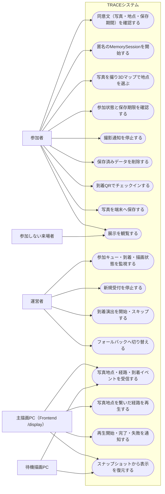
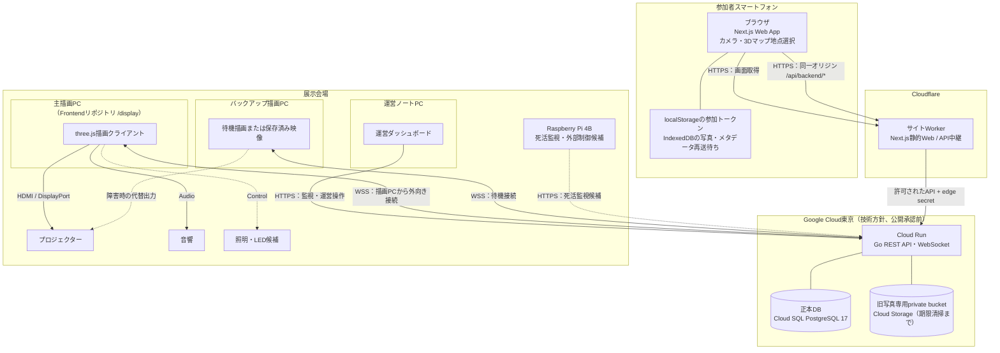
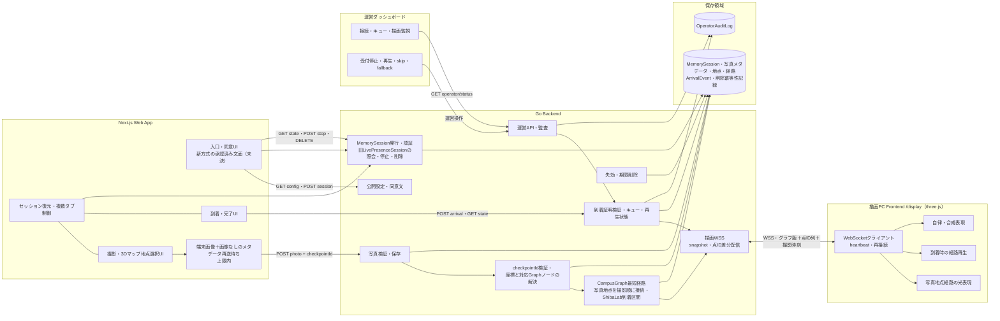
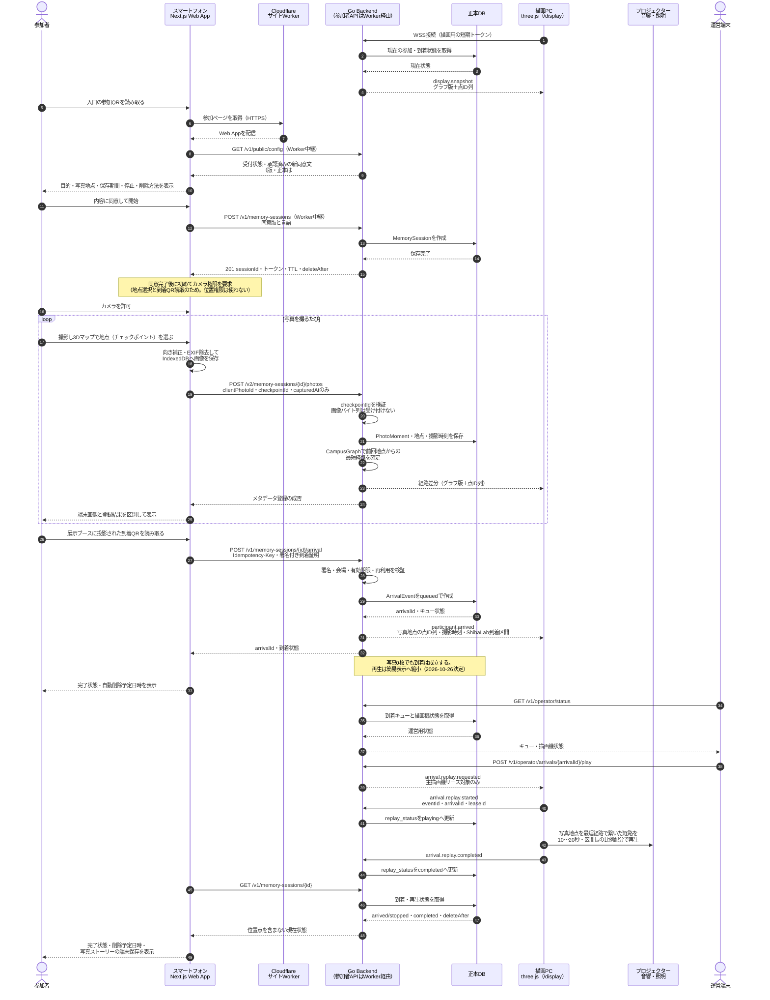
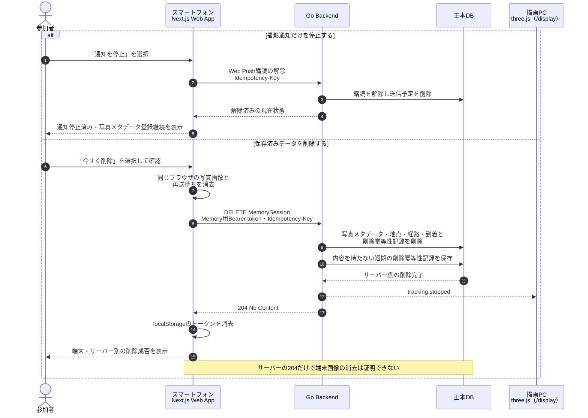
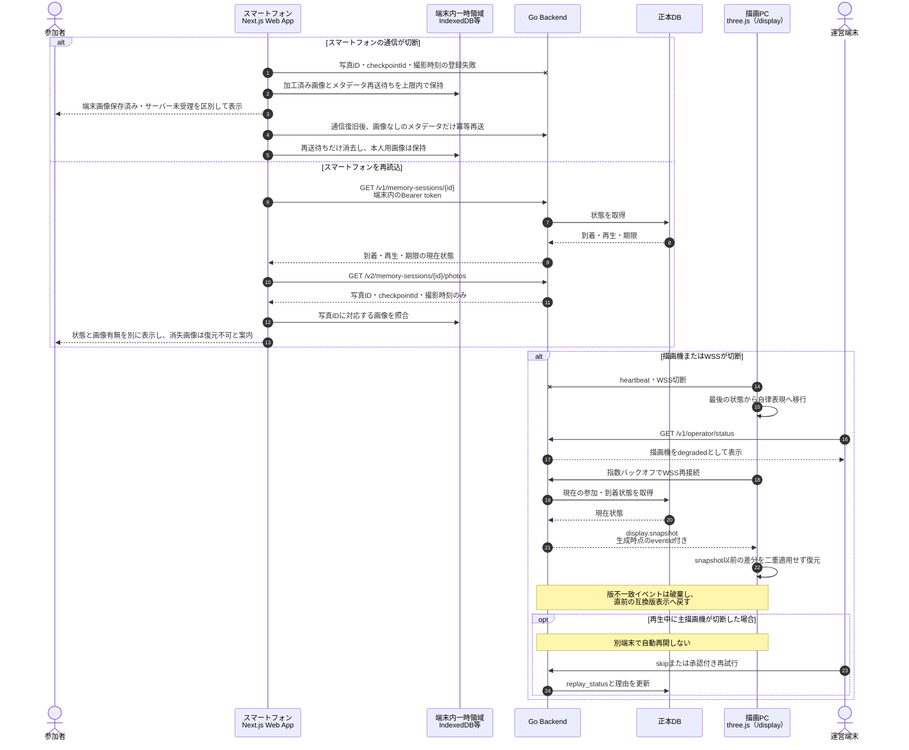

# UML図・システムフロー

この資料は、TRACEの設計書をもとに、利用者、各端末、フロントエンド、バックエンド、DB、描画システムの役割とデータの流れをMermaidで整理したものです。

本資料はGPSを用いない仕様（写真地点は参加者が3Dマップで選ぶ `checkpointId` のみ、MemorySession単独セッション）に沿って改訂した（2026-10-26決定、Issue #23）。通信契約は[API・WebSocket仕様](api.md)、状態の正本は[参加追跡・到着演出の状態遷移](state-machine.md)、保存内容は[データモデル](data-model.md)を優先します。実装中に仕様を変更した場合は、該当する設計書と本資料を同じ変更単位で更新します。

## 図の一覧

| 図 | 答える質問 | 優先度 |
|---|---|---:|
| ユースケース図 | 誰が何を操作するのか | 高 |
| 配置図 | どの端末で何が動くのか | 高 |
| コンポーネント図 | 各ソフトウェアが何を担当するのか | 高 |
| シーケンス図 | 端末間でデータがどの順番に流れるのか | 高 |

## ユースケース図

カメラを許可しない来場者は参加せず、展示を観覧できる前提です。位置情報の同意・位置権限は要求しません。カメラは写真撮影と到着QRの読取のために用います。旧草案版`2026-memory-photo-no-gps-draft-1`を新方式に再利用せず、同意文の正本・新しい版は#9で関係者相談・大学審査後に決めます。

### 権限上のポイント

- 参加者、運営者、描画PCは別々の資格情報を使用する
- 待機描画PCは通常配信とスナップショットを受信できるが、演出完了を確定できない
- 運営操作は運営者だけが実行でき、操作履歴を残す
- 参加に位置情報の同意を要求しない。位置権限を使わない
- 色・記号・`display_alias`・スマホ↔展示の照合表示は廃止した（2026-10-26、Issue #23）

## 配置図

技術方針はCloudflareサイトWorkerでNext.js静的Webと参加者APIの中継、Google Cloud東京でCloud RunとCloud SQL for PostgreSQL 17を採用する。追加の写真画像は端末内IndexedDBだけに置き、正本DBには写真ID・地点・撮影時刻と経路を保存する設計目標（未実装・承認待ち）である。非公開Cloud Storageは旧クラウド写真の本人照会・削除・各`deleteAfter`での清掃が終わるまで保持し、新規写真には使わない。大学の提供者・処理地域・費用承認と公開経路の検証は未完了。Cloudflareの処理・ログは東京保存の保証対象ではなく、会場PC上のBackendは開発・承認済み緊急構成に限定する。

### 配置上のポイント

- スマートフォンはCloudflareサイトWorkerの同一オリジンAPIへ外向き接続する。描画WSSは描画PCからGo（Cloud Run）への外向きWebSocket直接接続とし、Workerは中継しない（2026-10-26決定）
- 学内ネットワークから描画PCへの受信ポート開放を前提としない
- Cloud SQL PostgreSQL 17を新規写真メタデータ・経路の正本にする。非公開Cloud Storageは旧写真の本人閲覧・削除・期限清掃だけに使う。大学承認・予算承認・新しい同意文承認まで実データ受付を行わない
- 描画ソフトはthree.jsで決定済み（2026-10-26、Issue #12）。Frontendリポジトリの`/display`がそのまま描画クライアント
- Go BackendはOCI互換コンテナとする。AWS等への変更は別途決定する
- 主描画PC停止時はバックアップ描画または合成映像へ切り替える

## コンポーネント図

### コンポーネント間の責務

- Web Appは同意、写真画像の端末内保存と3Dマップ地点選択、写真ID・地点・撮影時刻だけの送信、参加者への状態表示、端末とサーバーの削除操作を担当する。座標・ノードID・グラフ版や画像をpayloadへ含めない
- Go Backendは認証、checkpointIdの検証と座標・ノード解決、最短経路再構成、保存、描画配信を担当する
- DBはMemorySession単独の参加状態と到着演出状態を保存する。旧LivePresenceSessionは`deleteAfter`までの期限清掃だけが対象
- 描画PCは点ID列・グラフ版・撮影時刻から表示を生成し、原写真・画像URL・生座標・生GPSを受け取らない
- 運営画面は監視と運営操作だけを担当する

## シーケンス図

### 参加から写真地点送信・到着再生まで

以下のブラウザ↔Go間のAPI矢印は業務フローの省略表現。実通信はすべてブラウザ→CloudflareサイトWorkerの同一オリジン`/api/backend/*`→Goであり、Workerがedge secretを付与する。描画WSSは描画PCからGo（Cloud Run）への外向きWebSocket直接接続とする（2026-10-26決定）。Workerは中継せず、描画用資格情報の発行契約はIssue #11で整備する。

### 参加者による撮影通知停止・データ削除

到着で撮影通知は自動停止する。ここでは任意の停止と削除を扱います。

### 通信断と再接続

## 図と実装で共通に守ること

- GPS・位置情報API（Geolocation、watchPosition）を参加フローで使用しない
- 同意文はカメラ許可のみを参加条件とし、位置情報の項目を含めない
- 参加者が送るpayloadに座標・対応ノードID・グラフ版を含めない（MemorySession単独方針）
- 参加者の資格情報はMemorySession単独とする。旧LivePresenceSessionは本人照会・停止・削除と期限清掃以外の用途を持たない
- 参加トークンをURL、ログ、描画イベントへ含めず、サーバーにはハッシュだけを保存する
- 描画機へ渡すのは点ID・グラフ版・撮影時刻であり、原写真・画像URL・生座標・生GPSは渡さない
- 到着は展示ブースの署名・期限付きQRのBackend検証でのみ成立し、ArrivalEvent作成と同じトランザクションで撮影通知の停止を登録する
- 到着、削除、描画完了は冪等に処理する
- 主描画機だけが到着演出の開始・完了を確定できる
- 通信断時は端末に写真画像と写真ID・`checkpointId`・撮影時刻のメタデータ再送待ちを上限付きで保持する。画像をネットワークへ再送しない。描画の自律表現と復旧時のスナップショットを使用する
- 本番の正本DBは一つだけとし、会場PC上のBackendと同時書き込みしない

## 統合前に確認が必要な点

以下は、図の作成時に設計書だけでは一意に判断できなかった点です。図では開発を進められるよう暫定的な流れを置いていますが、担当機能を統合する前に関係者で決定し、API仕様と本資料へ反映してください。

| 確認事項 | 現在の図での暫定解釈 | 統合前に決めること |
|---|---|---|
| 到着演出の開始方法 | 運営者が`POST /v1/operator/arrivals/{arrivalId}/play`を実行して開始する | 毎回手動で開始するか、Backendがキューから自動開始するか |
| `participant.arrived`と`arrival.replay.requested`の役割 | 到着時に`participant.arrived`で点ID列・撮影時刻を渡し、再生時に`arrival.replay.requested`を送る | 軌跡を受けた描画機が何をするか、差分とスナップショットの分担 |
| 参加者画面の状態更新 | `GET /v1/memory-sessions/{id}`で到着状態・削除予定日時を、`GET /v2/memory-sessions/{id}/photos`でサーバーメタデータを取得する。端末写真の有無はIndexedDBで判定 | ポーリング間隔、画面更新方法、参加者向け通知を追加するか |
| チェックポイント選択UIの粒度 | 図では3Dマップ上の一覧選択（実装PRは82点）と表記 | ポケモンGO風8か所スポット案との採否、写真地点の再選択（選び直し）の可否。uni-bit・code-yutoと相談中（Mino829/TRACE_F#38・#45） |
| 主描画機リース | 主描画機だけが再生開始・完了を送れるものとしている | リースの取得方法、有効時間、更新、切断時の解放、待機機への切替手順 |
| 描画WebSocketの差分復元 | `display.snapshot`のeventIdを基準に古い差分を捨てる | 採用するカーソル方式、順序逆転・欠落・再送の処理 |
| クラウド提供者 | CloudflareサイトWorker + Google Cloud東京（Cloud Run / Cloud SQL PostgreSQL 17）を新方式の技術方針として採用。非公開Cloud Storageは旧写真の期限清掃まで維持 | 大学の提供者・処理地域・個人情報承認と費用/公開経路の確認。Cloudflare側の東京処理は保証しない |
| PostgreSQL構成 | Cloud SQL for PostgreSQL 17を正本とする | 可用性、instance size、接続上限、7日上限のバックアップ/PITRと削除保証 |
| 描画ソフト | three.js採用済み（2026-10-26、Issue #12）。Frontendリポジトリ`/display` | 残る決定は主描画機リースとWSS認証（Issue #11） |
| Raspberry Pi・音響・照明 | 候補または任意接続として点線で表している | MVPに含める範囲、接続方式、障害時に切り離せる条件 |
| 写真0枚・1枚の到着 | 到着は成立し、再生は簡易表示（スポット名や写真の有無の案内）へ縮小する（2026-10-26決定） | 簡易表示の具体的な絵作り・文言 |

旧契約の位置系の暫定解釈（`on_site`追加同意、使用する精度、ExperienceLink、両セッションDELETEの応答など）は2026-10-26の決定（Issue #23）で廃止したため、本表から削除した。

### 統合時の更新ルール

- 決定した項目は「暫定解釈」のまま残さず、該当する図と設計書へ反映する
- APIまたはイベントを変更した場合は、送信側と受信側の担当者が同じ内容で合意する
- 未決の機能はインターフェースをモック化し、統合時に暗黙の仕様を持ち込まない。GPSに紐づく旧表現は復活させない
