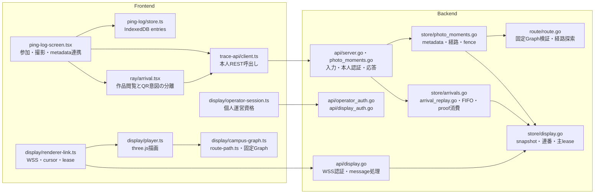
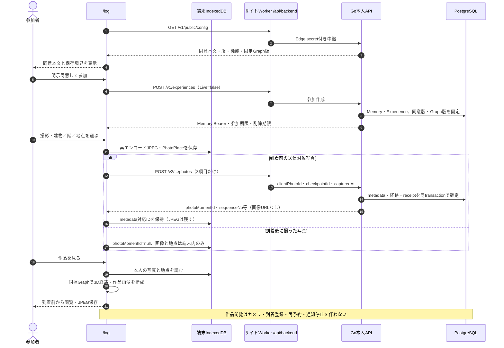
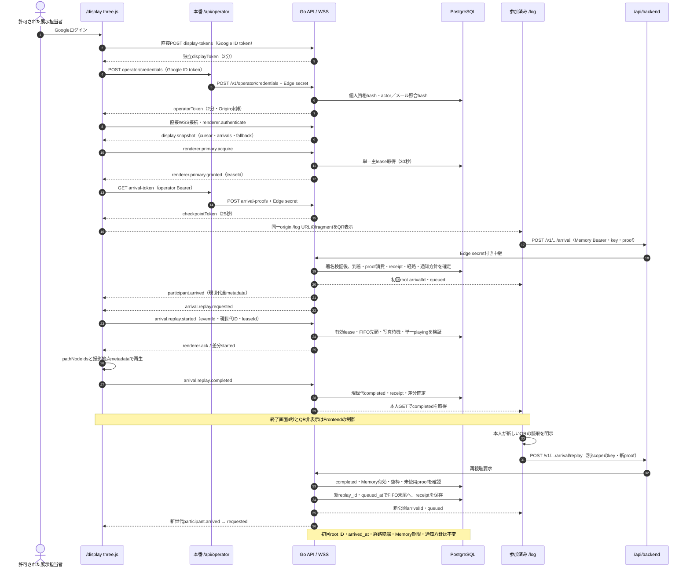
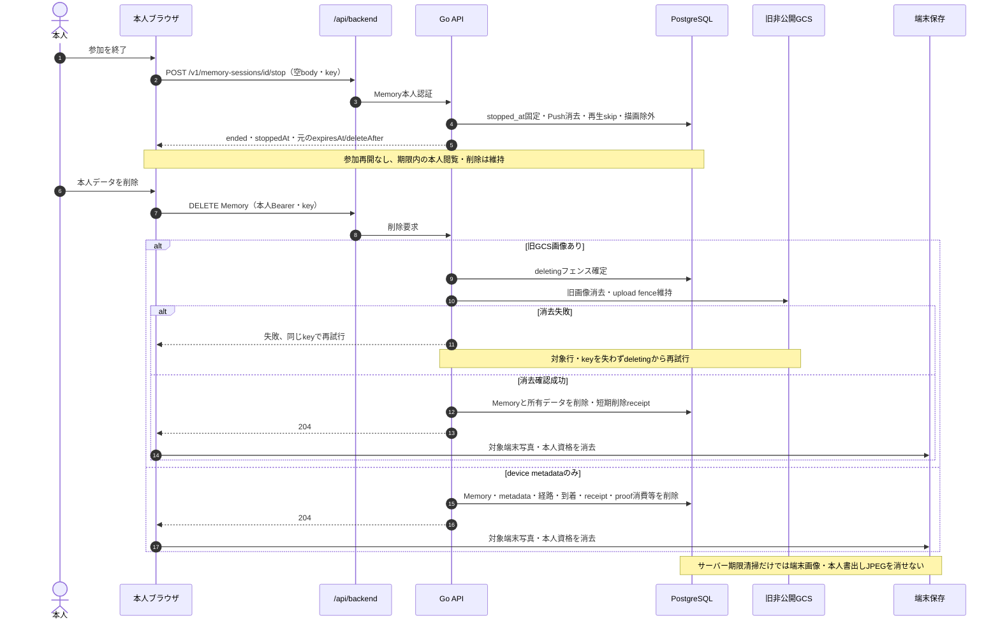

# UML図・システムフロー（完成版）

更新日: 2026-11-06

Frontend `be94bd2`／Backend `6b87961`（schema 20）の構造と主要シーケンスを示す。存在しないGPS送信、写真pin／hotspot、Unity／TouchDesignerを完成機能として描かない。実装存在と配備・承認・実機試験の完了を区別する。

配置境界は[システム構成](architecture.md#全体構成)、物理FKは[データモデル](data-model.md#er図)、状態図は[状態遷移](state-machine.md)、wire形式は[API仕様](api.md)に集約する。本書で同じ配置図・ER図・状態図を重複定義しない。

## 図の一覧

| 図 | 答える質問 |
|---|---|
| コンポーネント図 | 実在するどのモジュールが入出力・正本更新・描画を担当するか |
| 写真保存・作品閲覧シーケンス | 画像本体を送らず、ローカル作品を到着と独立して開く流れは何か |
| Google認証・初回到着・本人再視聴シーケンス | 資格・proof・初回到着・現再生世代・FIFOをどう分離するか |
| 停止・削除シーケンス | 停止で本人権利を残し、旧画像を安全に消す流れは何か |

## コンポーネント図

実在ファイルの責務依存を表す。矢印はモジュール間の利用・データ受渡しで、すべてが直接ネットワーク接続するという意味ではない。実通信はWorker／直接WSSの境界を通る。

運営用operatorTokenとWSS用displayTokenの発行は独立。Graphは同梱JSONで、DBのCampusNode／CampusEdge表ではない。DBの行・所有関係はデータモデルを参照する。

## シーケンス図

### 写真保存・作品閲覧

写真本体はEdge、Go、GCS、展示PCへ送らない。サーバー到着終端と独立したローカルShibaLabへの作品経路を利用できる。写真0枚では作成できない案内を出す。API失敗を端末だけの参加成功で代替しない。

### Google認証・初回到着・本人再視聴

上図のHTTP応答はWorker経由を含む論理応答の省略表現。直接描画token／WSSにEdge secretを渡さない。運営資格を拒否されても描画だけ許可される場合はその権限範囲で継続し、偽QRを作らない。

同じ初回arrivalの回復は初回IDと現在状態を返すだけ。本人再視聴receiptの同キー・同body再送は保存済み成功応答で、新規予約しない。使用済みproofはMemoryごと再消費できず、別Memoryの同QR利用は可能。キュー満杯／競合はproof消費もreceiptもロールバックする。

待機接続は主leaseを持たないため、再生確定できない。playing中切断・lease失効はrenderer_failure skipで、別機への自動再生引継ぎはしない。運営障害retryだけが新世代を末尾へ入れる。

### 参加者による停止・データ削除

旧Liveは別本人Bearerで照会・停止・削除する。Memoryを削除しても旧Live自身のdeleteAfterまでの本人権利を失わせない。一括削除だけはMemory＋Live両資格を要求し、Live成功後にMemoryを別確定する。HTTP 200のpendingは未完了で、同じキー・両資格で未完了側を再試行する。

## 図と実装で共通に守ること

- GPSを新規取得・送信せず、旧データの本人権利と清掃を残す。
- 参加・描画・個人運営の資格を混ぜず、Edge secret・proof署名鍵はサーバー側だけに置く。
- 本番operator bridgeは資格発行・失効・proof取得だけ。status／受付停止／全通知停止／fallback／skip／retryはこのbridgeに存在せず、別の認可済み運営経路を必要とする。
- 画像本体は端末内、展示は版付きnode ID列と撮影地点・時刻metadata。公開差分に本人資格・Memory ID・画像URL・生GPSを載せない。
- 初回到着rootと公開再生世代を分離し、現世代以外の開始・完了を受理しない。通常待機30秒skipや毎回手動playは使わない。
- snapshotで全置換し、DB連番差分と制御応答IDを区別する。欠番を推測で埋めない。
- 新同意版で作ったMemoryの到着後通知方針を固定し、既存Memoryの同意・停止・期限を変更しない。
- 会期終了から現在の全停止・削除完了・撤収を推定しない。図は実行済み試験結果ではない。

## 実装参照

- [Frontend画面・本番境界](https://github.com/Mino829/TRACE_F/blob/be94bd2/README.md)、[Workerの限定経路](https://github.com/Mino829/TRACE_F/blob/be94bd2/push-worker/src/site.ts)
- [端末写真保存](https://github.com/Mino829/TRACE_F/blob/be94bd2/src/lib/ping-log/store.ts)、[作品閲覧／到着意図](https://github.com/Mino829/TRACE_F/blob/be94bd2/src/components/ping-log/ray/arrival.tsx)
- [本人API](https://github.com/Mino829/TRACE_B/blob/6b87961/internal/api/server.go)、[v2 metadata](https://github.com/Mino829/TRACE_B/blob/6b87961/internal/api/photo_moments.go)
- [初回到着](https://github.com/Mino829/TRACE_B/blob/6b87961/internal/store/arrivals.go)、[再視聴](https://github.com/Mino829/TRACE_B/blob/6b87961/internal/store/arrival_replay.go)、[主lease・FIFO・snapshot](https://github.com/Mino829/TRACE_B/blob/6b87961/internal/store/display.go)
- [Memory停止](https://github.com/Mino829/TRACE_B/blob/6b87961/internal/store/memory_sessions.go)、[旧画像削除・fence](https://github.com/Mino829/TRACE_B/blob/6b87961/internal/photo/service.go)
